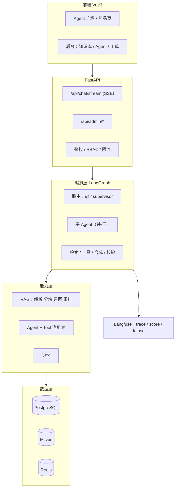

# 花红 Agent 应用平台（HHAgent）

面向医药电商场景的 **多 Agent + RAG 平台** 全栈实现，同时作为投递花红药业「Agent 应用开发」岗位的作品。

核心主张：**Agent 是配置，工具是代码；知识库是数据，权限在检索层；每一步都可观测。**

- 需求文档：[docs/需求文档.md](docs/需求文档.md)
- 任务拆分：[docs/任务清单.md](docs/任务清单.md)

---

## 当前进度

| 模块 | 状态 | 说明 |
| --- | --- | --- |
| 全栈骨架（FastAPI + Vue3/Vant + PG + Redis） | ✅ | 登录、RBAC、药品 CRUD、购物车、订单 |
| 药品入库 Agent（自然语言 → 结构化表单） | ✅ | `/api/agent/parse-product` |
| 药品咨询 Agent | 🟡 | 可用，但仍是「整段说明书塞 prompt」的过渡实现，M1 替换为真 RAG |
| 统一模型工厂 | ✅ | 单一入口，温度/超时/重试集中，缺 key 给 503 而不是崩 |
| 数据库迁移 | ✅ | Alembic（老库自动 stamp，不重复建表） |
| 分层接口契约 | ✅ | LLM / Retriever / Tool / Memory / TraceSink 六个 Protocol + 测试替身 |
| 可观测（Langfuse） | ✅ | 一键开关，未配置即 no-op，绝不阻塞回答 |
| CI | ✅ | ruff + pytest + 前端构建 |
| **多知识库 RAG（Milvus）** | 🚧 | M1 进行中：解析 / 分块 / 混合检索 / 权限过滤 / 检索测试台 |
| 多 Agent 与 `@` 协作 | 📋 | M2 |
| 记忆系统 + 转人工 | 📋 | M3 |
| 评估集与指标看板 | 📋 | M4 |

---

## 架构



---

## 快速开始

**前置**：Docker Desktop、Python 3.11、Node 20+。

```powershell
# 1. 依赖
python -m venv .venv
.\.venv\Scripts\pip install -r backend\requirements.txt
cd frontend; npm install; cd ..

# 2. 配置（把 your_key 换成真实值；Langfuse 可留空）
Copy-Item .env.example .env

# 3. 起依赖（PG / Redis / Milvus），首次约 90 秒
.\script\dev.ps1 up

# 4. 建表 + 演示数据
.\script\dev.ps1 init
.\script\dev.ps1 seed

# 5. 起服务（两个终端）
.\script\dev.ps1 backend    # http://127.0.0.1:8000/docs
.\script\dev.ps1 frontend   # http://127.0.0.1:5173
```

演示账号（由 `script/seed_users.py` 生成）：`admin` / `doctor` / `patient`，密码均为 `123456`。

> 本机直接跑后端时 `POSTGRES_SERVER=localhost`；若用 compose 里的 backend 容器则应为 `db`
> （compose 已通过环境变量覆盖）。

---

## 端口

| 服务 | 端口 | 说明 |
| --- | --- | --- |
| 前端 Vite | 5173 | 开发服务器，`/api` 走代理 |
| 后端 FastAPI | 8000 | `/docs` 交互文档，`/health` 健康检查 |
| PostgreSQL | 5432 | 业务库（含 pgvector 扩展） |
| Redis | 6379 | 缓存 / 后续的会话与队列 |
| Milvus | 19530 / 9091 | gRPC / 健康检查 |
| MinIO | 9000 / 9001 | Milvus 对象存储 / 控制台 |

---

## 常用命令

| 命令 | 作用 |
| --- | --- |
| `.\script\dev.ps1 up` | 启动依赖服务 |
| `.\script\dev.ps1 status` | 查看容器状态 |
| `.\script\dev.ps1 init` | Alembic 建表 / 升级 |
| `.\script\dev.ps1 seed` | 灌演示数据 |
| `.\script\dev.ps1 test` | 单元测试（不连外部服务） |
| `.\script\dev.ps1 lint` | ruff |
| `.\script\dev.ps1 check` | **提交前跑**：lint + test + 前端构建 |
| `.\script\dev.ps1 langfuse` | Langfuse 连通性自检 |

手动执行等价命令：

```powershell
.\.venv\Scripts\python -m pytest -q
.\.venv\Scripts\python -m ruff check backend
.\.venv\Scripts\python script\init_db.py
```

---

## 可观测（Langfuse）

- 开关只看 `.env` 的 `LANGFUSE_PUBLIC_KEY / LANGFUSE_SECRET_KEY / LANGFUSE_BASE_URL`，
  **任一为空即整体关闭**，服务行为与未接入时完全一致。
- 自检：`.\script\dev.ps1 langfuse`，或在后台看 trace `agent.parse_product`。
- 埋点位置：`app/observability/`。业务代码只调 `get_trace_sink()`，从不直接 import SDK。
- 注意：`get_trace_url()` 会同步请求 Langfuse API，只允许出现在运维脚本里。

---

## 测试

```powershell
.\script\dev.ps1 test
```

- 单元测试**不连任何外部服务**（LLM / Milvus / PG / Langfuse），一律用 `app/testing/fakes.py`。
- 需要真实依赖的用例打 `@pytest.mark.integration`，默认跳过；`$env:RUN_INTEGRATION=1` 开启。

---

## 目录结构

```
backend/
├── app/
│   ├── agent/          # 编排（M2）
│   ├── api/            # 路由
│   ├── core/           # 配置 / 数据库 / 安全
│   ├── guardrail/      # 输出治理（M4）
│   ├── llm/            # 模型工厂 + 契约
│   ├── memory/         # 记忆（M3）
│   ├── models/         # ORM
│   ├── observability/  # Langfuse 接入 + 追踪契约
│   ├── rag/            # 解析/分块/检索（M1）
│   ├── schemas/        # Pydantic
│   ├── services/       # 业务服务
│   ├── testing/        # 测试替身
│   └── tools/          # Function Calling 注册表
├── alembic/            # 数据库迁移（alembic.ini 必须纯 ASCII）
└── tests/              # unit / integration / eval
frontend/src/           # Vue3 + Vant
docs/                   # 需求文档、任务清单
script/                 # dev.ps1、种子数据、自检脚本
```

---

## 已知约束

- 药品咨询 Agent 目前是**过渡实现**（把说明书整段拼进 prompt），M1-17 会替换为检索 + 引用 + 拒答。
- 前端暂无 e2e，靠手工回归清单保障。
- `docs/任务清单.md` 的估时按全职 40h/周计算，约 7 周完成全部里程碑。
