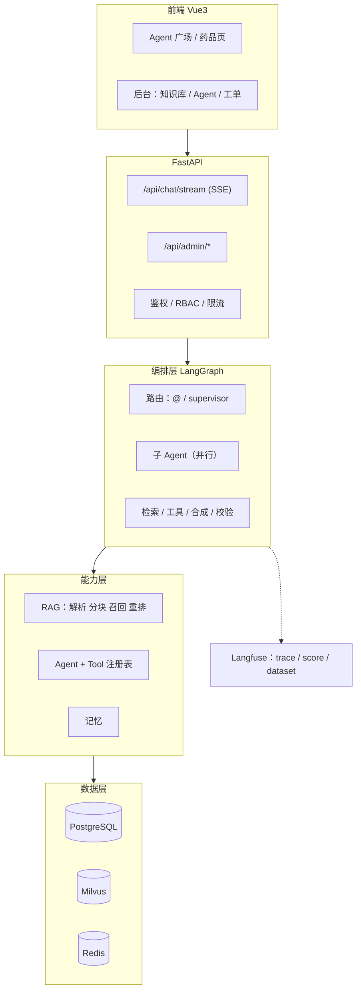
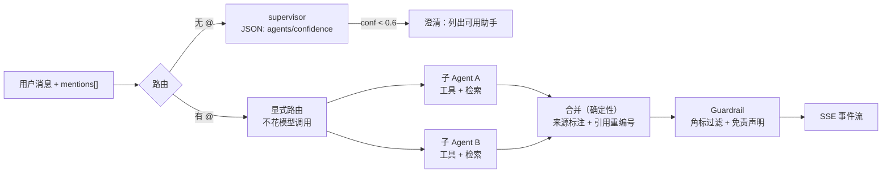
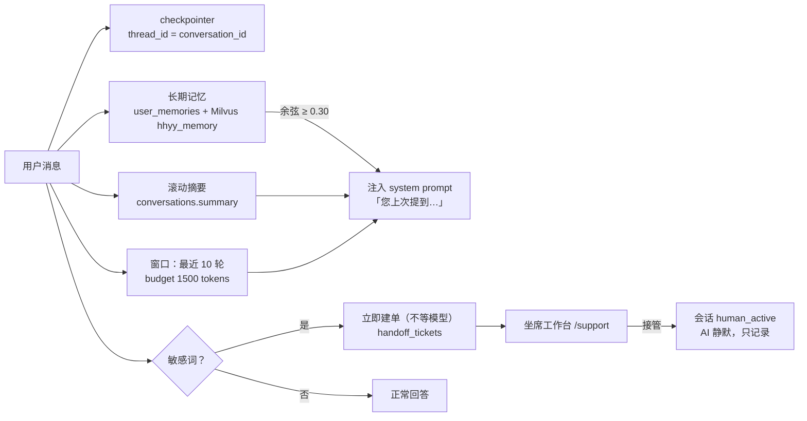

# 花红 Agent 应用平台（HHAgent）

面向医药电商场景的 **多 Agent + RAG 平台** 全栈实现，同时作为投递花红药业「Agent 应用开发」岗位的作品。

核心主张：**Agent 是配置，工具是代码；知识库是数据，权限在检索层；每一步都可观测。**

- 需求文档：[docs/需求文档.md](docs/需求文档.md)
- 任务拆分：[docs/任务清单.md](docs/任务清单.md)

---

## 当前进度

| 模块 | 状态 | 说明 |
| --- | --- | --- |
| 全栈骨架（FastAPI + Vue3/Vant + PG + Redis） | ✅ | 登录、RBAC、药品 CRUD、购物车、订单 |
| 药品入库 Agent（自然语言 → 结构化表单） | ✅ | `/api/agent/parse-product` |
| 药品咨询 Agent | ✅ | M1 已改为真 RAG：检索 + `[n]` 引用 + 低分拒答（`/api/agent/drug-consult`） |
| 统一模型工厂 | ✅ | 单一入口，温度/超时/重试集中，缺 key 给 503 而不是崩 |
| 数据库迁移 | ✅ | Alembic（老库自动 stamp，不重复建表），0001 baseline + 0002 知识库 + 0003 多 Agent/会话 + 0004 记忆/工单 + 0005 评估/治理（checkpointer 的表由库自带 `setup()` 建） |
| 分层接口契约 | ✅ | LLM / Retriever / Tool / Memory / TraceSink 六个 Protocol + 测试替身 |
| 可观测（Langfuse） | ✅ | 一键开关，未配置即 no-op，绝不阻塞回答 |
| CI | ✅ | ruff + pytest + 前端构建 |
| **多知识库 RAG（Milvus）** | ✅ | M1：解析 / 分块 / 混合检索（BM25+dense+RRF）/ 重排 / 角色 ACL / 检索测试台 |
| **多 Agent 与 `@` 协作** | ✅ | M2：Agent 配置化注册 / `@` 并行 / SSE 流式 / 引用与免责声明 / 幂等与限流 |
| **记忆系统 + 转人工** | ✅ | M3：checkpointer 短期记忆 / 语义记忆 / 敏感场景秒级建单 / WS 坐席端 / AI 静默 |
| **评估、治理与演示** | ✅ | M4：golden set 50 条（recall@5 0.94 / 拒答 0.94）/ 合规词表与流式改写 / Prompt 版本与灰度 / 指标看板 / 👍👎 反馈闭环 |

---

## 架构



---

## 快速开始

**前置**：Docker Desktop、Python 3.11、Node 20+。

```powershell
# 1. 依赖
python -m venv .venv
.\.venv\Scripts\pip install -r backend\requirements.txt
cd frontend; npm install; cd ..

# 2. 配置（把 your_key 换成真实值；Langfuse 可留空）
Copy-Item .env.example .env

# 3. 起依赖（PG / Redis / Milvus），首次约 90 秒
.\script\dev.ps1 up

# 4. 建表 + 演示数据
.\script\dev.ps1 init
.\script\dev.ps1 seed

# 5. 起服务（两个终端）
.\script\dev.ps1 backend    # http://127.0.0.1:8000/docs
.\script\dev.ps1 frontend   # http://127.0.0.1:5173
```

演示账号（由 `script/seed_users.py` 生成）：`admin` / `doctor` / `patient`，密码均为 `123456`。

> 本机直接跑后端时 `POSTGRES_SERVER=localhost`；若用 compose 里的 backend 容器则应为 `db`
> （compose 已通过环境变量覆盖）。

---

## 端口

| 服务 | 端口 | 说明 |
| --- | --- | --- |
| 前端 Vite | 5173 | 开发服务器，`/api` 走代理 |
| 后端 FastAPI | 8000 | `/docs` 交互文档，`/health` 健康检查 |
| PostgreSQL | 5432 | 业务库（含 pgvector 扩展） |
| Redis | 6379 | 缓存 / 后续的会话与队列 |
| Milvus | 19530 / 9091 | gRPC / 健康检查 |
| MinIO | 9000 / 9001 | Milvus 对象存储 / 控制台 |

---

## 常用命令

| 命令 | 作用 |
| --- | --- |
| `.\script\dev.ps1 up` | 启动依赖服务 |
| `.\script\dev.ps1 status` | 查看容器状态 |
| `.\script\dev.ps1 init` | Alembic 建表 / 升级 |
| `.\script\dev.ps1 seed` | 灌演示数据（账号 + 药品） |
| `.\script\dev.ps1 kb` | 灌知识库种子（4 库 13 文档，真实调用 embedding） |
| `.\script\dev.ps1 agents` | 灌 Agent 与 Prompt 模板（4 个 Agent，纯 DB 写入） |
| `.\script\dev.ps1 test` | 单元测试（不连外部服务） |
| `.\script\dev.ps1 lint` | ruff |
| `.\script\dev.ps1 check` | **提交前跑**：lint + test + 前端构建 |
| `.\script\dev.ps1 langfuse` | Langfuse 连通性自检 |

手动执行等价命令：

```powershell
.\.venv\Scripts\python -m pytest -q
.\.venv\Scripts\python -m ruff check backend
.\.venv\Scripts\python script\init_db.py
```

---

## 可观测（Langfuse）

- 开关只看 `.env` 的 `LANGFUSE_PUBLIC_KEY / LANGFUSE_SECRET_KEY / LANGFUSE_BASE_URL`，
  **任一为空即整体关闭**，服务行为与未接入时完全一致。
- 自检：`.\script\dev.ps1 langfuse`，或在后台看 trace `agent.parse_product`。
- 埋点位置：`app/observability/`。业务代码只调 `get_trace_sink()`，从不直接 import SDK。
- 注意：`get_trace_url()` 会同步请求 Langfuse API，只允许出现在运维脚本里。

---

## 知识库与 RAG（M1）

### 一句话架构

知识库是**数据**不是代码：后台建库 → 传文档 → 勾权限，前台检索自动生效。
向量统一落在单个 Milvus collection `hhyy_kb_chunks`，靠 `kb_id` 标量索引隔离。

### 权限怎么生效

| 层 | 判什么 | 在哪 |
| --- | --- | --- |
| 功能 RBAC | 能不能进后台 / 调某个接口 | `Depends(require_roles([...]))` |
| 数据 ACL | 这次检索能召回哪些库的 chunk | `app/rag/acl.py` 产出 `kb_id in [...]`，**拼进 Milvus 的 filter 表达式** |

三条不能破的规则：

1. **默认拒绝**：新建库没有任何授权行 = 谁都检索不到（只有 `visibility=public` 例外）。
2. **过滤下推到向量库**：绝不「先召回 30 条再过滤」——那要么答不出，要么泄露。
3. **权限变更 ≤30s 生效**：Redis 缓存 key 带版本号，写操作 `INCR version` 即整体失效。

### 检索链路

```
query ──(有历史→LLM 改写)──> embedding
   ├─ dense:  top30 (COSINE)
   ├─ sparse: top30 (Milvus 内置 BM25，chinese analyzer)
   ├─ RRF(k=60) 融合
   ├─ gte-rerank-v2 重排 → top5
   └─ 阈值：top1 < 阈值 → 拒答（不回退、不编造）
```

**阈值有两个，因为两种分数虽然都在 0~1，分布却差一个数量级**：

| 打分口径 | 阈值 | 实测依据 |
| --- | --- | --- |
| 重排分（正常路径） | `RERANK_SCORE_THRESHOLD=0.15` | 10 正 / 10 负问题：负例最高 0.135，正例最低 0.175 |
| 余弦相似度（重排降级时） | 库级 `score_threshold`（0.35 / 0.40） | 无关问题也能到 0.69，泛问句只有 0.28 |

用一个数卡两种分数，结果是「重排路径全拒、余弦路径全放」。RRF 融合分只有 0.0x
量级，永远不能直接当阈值判据——这个取舍写在 `app/rag/retriever.py` 的模块注释里。

> 排障提示：`gte-rerank`（老模型名）在本账号返回 403 `AccessDenied`，可用的是
> `gte-rerank-v2`。重排一旦静默降级，症状是「泛问句全被拒答」，很像阈值调错了。

### 后台接口

| 方法 | 路径 | 说明 |
| --- | --- | --- |
| GET/POST | `/api/admin/kb` | 列表（含文档数/chunk 数）/ 新建 |
| GET/PUT/DELETE | `/api/admin/kb/{id}` | 详情 / 修改 / 删除（连向量一起删） |
| GET/POST | `/api/admin/kb/{id}/documents` | 文档列表（状态轮询）/ 上传（file \| url \| text） |
| POST | `/api/admin/kb/{id}/documents/{doc_id}/reindex` | 重新解析（游标清零，全量重建） |
| POST | `/api/admin/kb/{id}/documents/{doc_id}/retry` | 失败重试（保留游标，断点续传） |
| GET | `/api/admin/kb/{id}/documents/{doc_id}/chunks` | 分段列表 |
| PUT | `/api/admin/kb/{id}/chunks/{chunk_id}` | 改正文 → **只重建这一条**向量 |
| GET | `/api/admin/kb/permissions` | 权限矩阵（库 × 角色） |
| PUT | `/api/admin/kb/{id}/permissions` | 保存授权（全量覆盖 + 审计 + 失效缓存） |
| POST | `/api/admin/kb/{id}/search-test` | **检索测试台**：以任意角色身份检索 |
| GET | `/api/admin/kb/stats` | 文档/chunk 数、7 日检索次数、零召回榜 |

### 五分钟演示（这是 M1 最值钱的一段）

1. `.\script\dev.ps1 kb` → 4 个库 13 篇文档全部 `ready`
2. admin 登录 → `/admin/kb` → 看到 4 个库的文档数与 chunk 数
3. `/admin/kb/permissions` → 看「说明书 = patient/doctor/support，SOP = 仅 support」
4. `/admin/kb/search-test` → 点顶部「快捷用例」里的 **游客问售后**：同一句「七天无理由退货吗」，
   `visitor` 显示「被过滤：订单与售后政策」、`low_score` 拒答；换成 **售后政策**（patient）立刻命中
   —— **权限是在检索层生效的**。另外 `越权查 SOP` 演示 `no_permission`（拒绝 ≠ 没搜到）。
5. 药品详情页问「哺乳期能吃吗」→ 回答带 `[1]` 角标，引用指向说明书【禁忌】

> 测试台默认「全部库 + patient」，页面会显示 `top_score / 阈值` 和打分口径。
> 拒答时也会把「差一点」的片段列出来——看不到分数就只能靠猜是权限、召回还是阈值的问题。

---

## 多 Agent 与流式对话（M2）

### 一句话架构

> **Agent 是配置，工具是代码**：往 `agents` 表插一行（选知识库 + 选工具 + 指定 prompt 模板）
> 就是一个新 Agent，不需要改编排、不需要发版。编排层只读 `AgentConfig`。



LangGraph 图：`route → (clarify | dispatch) → compose → guardrail`。状态只放业务字段
（M3 接 checkpointer 时不动节点），数据库会话/模型/追踪挂在运行时上下文上。

### 四个内置 Agent（`dev.ps1 agents`）

| code | 名称 | 知识库 | 工具 | 可见角色 |
| --- | --- | --- | --- | --- |
| `drug_consult` | AI 药师 | `kb_drug_manual` | kb_search / product_lookup / escalate_human | 患者、医生、客服、管理员 |
| `order_after_sale` | 订单售后 | `kb_after_sale` | order_lookup / policy_search / escalate_human | 患者、医生、客服、管理员 |
| `company_intro` | 企业介绍 | `kb_company`（public） | kb_search | **游客** + 全部登录角色 |
| `customer_service` | 客服助手 | `kb_sop` + `kb_company` | kb_search / escalate_human | 仅客服、管理员 |

`@` 候选列表与广场卡片都按角色过滤——**游客只看到「企业介绍」，患者看不到内部 SOP 助手**。

### 工具（Function Calling 注册表）

| 工具 | 作用 | 关键约束 |
| --- | --- | --- |
| `kb_search` | 查 Agent 绑定的知识库 | 库 code ∩ 调用方 ACL，过滤仍在检索层 |
| `policy_search` | 售后政策快捷检索 | 固定限定 `kb_after_sale` |
| `product_lookup` | 按名称/ID 查药品 | 结构化查询，不走向量 |
| `order_lookup` | 查订单与物流 | **只能看自己的**，看别人的返回 `FORBIDDEN`；support/admin 例外 |
| `remember` | 记忆草稿 | M3 会换成真正的记忆存储 |
| `escalate_human` | 请求转人工 | 敏感词（投诉/赔偿/过量…）自动触发 |

权限在**工具层**校验（`required_roles` + 数据归属），不依赖上层「记得检查」；
工具异常一律收敛成 `ToolResult(ok=False)`，单个工具挂掉不会让整条回答 500。

### SSE 事件协议（前端契约见 `docs/接口契约-M2.md`）

```
meta → route → agent(start) → tool / retrieval → agent(done) → citation → delta… → [handoff] → done
```

- 任何异常路径都必须以 `error` 或 `done` 收尾（`to_sse` 兜底），否则前端只能干等到超时。
- `delta` 里已经出现的角标**当场过滤**：`[9]` 不在本次上下文里就丢弃（流式下「先发后校验」不成立）。
- 药品类 Agent 的回答末尾必带免责声明（`guardrail.flags` 会记录 `disclaimer_injected`）。

### 实测延迟（deepseek-flash，本机）

| 场景 | 耗时 | 说明 |
| --- | --- | --- |
| 单 Agent（supervisor + 检索 + 流式生成） | 4.2~4.9s | 路由 1s + 检索 0.8s + 生成 2.5s |
| 双 `@` 并行（两路各答一段） | **5.0s** | 两路并行 2.9s + 确定性合并（≈0s） |
| 澄清 | 1.2s | 一次路由调用，不生成 |

> 多 Agent 汇总**默认不用模型**：来源由代码拼接、引用按全局重编号。理由有三条——
> 少一次完整生成（实测 9.4s → 5.0s）、绝不会把 A 的结论说成 B 的、归因可以断言。
> 需要更连贯的措辞时把 `CHAT_LLM_SYNTHESIS=true` 打开即可切回模型融合。

### 三分钟演示

1. `.\script\dev.ps1 agents` → `/agents` 广场：游客只看到「企业介绍」，登录后 3 个
2. 药品详情页问「哺乳期能吃吗」→ 逐字流式 + 可点开的 `[1]` 角标 + 免责声明
3. 同页输入 `@` → 选「订单售后」→ 问「我这单能退吗」→ 回答只讲订单维度（不越界）
4. 一条消息 `@AI药师 @订单售后 哺乳期能吃吗？这单能退吗？`→ 两段带来源的结论（≈5s）
5. 不 `@` 直接问「你们公司是做什么的」→ supervisor 自动路由到「企业介绍」（路由理由可见）
6. `/api/admin/agents` 新建一个 Agent（选库 + 选工具）→ 刷新 `/agents` 立刻出现

---

## 记忆与转人工（M3）

### 一句话架构

**短期记忆交给 checkpointer，长期记忆交给「结构化 + 向量」两套存储，转人工是一张单向状态机。**



### 三层记忆各自解决什么

| 层 | 存放 | 生命周期 | 解决的问题 |
| --- | --- | --- | --- |
| 图状态 | LangGraph checkpointer（PG） | 会话内 | 重启进程/换 worker 后同一 `conversation_id` 仍能续上下文 |
| 短期 | 最近 10 轮 + `conversations.summary` | 会话内 | prompt 不随轮次线性膨胀（硬预算 1500 token） |
| 长期 | `user_memories` + Milvus `hhyy_memory` | 180 天，可删 | 跨会话记住过敏史/偏好/禁忌 |

写入是**异步**的（回答结束才跑），失败只记日志：记忆是加分项，不能拖慢或拖垮回答。
抽取先走规则（「我对青霉素过敏」不需要模型），规则没命中再问模型；入库前 PII 脱敏
（手机号/身份证/地址），相似记忆按归一化文本 + bigram 相似度去重。

### 转人工的五类触发

| 触发 | 行为 |
| --- | --- |
| 用户点「转人工」 | 立即建单 |
| 模型调 `escalate_human` | 立即建单 |
| 敏感词（投诉/纠纷/赔偿/过量/自杀…） | **进流前就建单**，坐席端 1 秒内可见 |
| 连续 2 次拒答 | 只给「转人工」按钮 |
| 连续 2 轮负面情绪 | 只给「转人工」按钮 |

状态机只允许单向流转（`queued → assigned → resolved`，`queued → offline`），
非法流转返回 409 而不是静默改状态——工单是要给人看的，悄悄改比报错更难查。

### 坐席通道

- `POST /api/support/ws-ticket` 换一张 60 秒一次性票据 → `WS /ws/support/{conversation_id}`
  第一帧 `{"type":"auth","ticket":"..."}`。JWT 永不进 query string。
- 广播走 Redis Pub/Sub（channel `hhyy:support:{conversation_id}`），Redis 不可用时退化为进程内广播，
  单人演示仍然可用。
- 接管后 `conversation.status=human_active`，`/api/chat/stream` **不再调模型**，
  只把用户消息落库 + 广播，并返回 `done(silenced=true)`。

### 三分钟演示（续 M2 之后）

> Agent 页右上角的 **✨ 演示提问** 面板按「知识库问答 / 上下文追问 / 长期记忆 / 转人工 / 多 Agent」分组，
> 每条都标注了「这一问能看到什么」，点一下直接发送——演示时不需要临场想问题。

1. 登录 `patient/123456`，在药品页问「我对青霉素过敏」→ 回答结束
2. 新建会话问「这个药我能吃吗」→ 回答里出现「您上次提到对青霉素过敏…」（`memory` 事件可展开看命中了哪条）
3. 打开 `/me/memory` → 看到这条记忆 → 删掉/关掉开关 → 再问一次，不再提及
4. 说「我吃了这个药不舒服，我要投诉」→ 立刻出现「正在为你转接，当前第 1 位」
5. 另开窗口用 `support/123456` 进 `/support` → 待接入卡片带交接摘要 → 接管 → 发一句话
6. 患者端立刻收到「客服：…」；此后 AI 不再回答（只有人工消息）
7. 坐席点「结束会话」→ 工单 `resolved`，**会话回到 `bot_active`（AI 接回来）**，再问还能继续答、也能再次转人工

### 实测（本机，deepseek-flash）

| 场景 | 结果 |
| --- | --- |
| 会话 A 写入过敏史 | 1 条 `risk` 记忆，1 个后台任务（不阻塞回答） |
| 会话 B 主动提及 | `memory` 事件 1 条、`memory_used=1`、回答含「您上次提到…」 |
| 无关问题（退款） | 记忆相似度 0.17~0.25 < 门槛 0.30，不注入 |
| 敏感场景建单 | 在 `route` 之后、`delta` 之前就返回 `handoff.ticket_id` |
| 工单摘要 | 建单时先落确定性摘要，流式结束后模型润色：`intent` / `tried_steps` / `risk_flags` / `suggested_reply` 都是真实诉求，不是「敏感场景，立即转人工」 |
| 排队阶段实时连接 | 患者端在 `handoff_pending` 就连 WS；坐席一接管，1s 内收到 `status=human_active`（帧里带坐席名） |
| 双向对话 | 患者 WS 发言 → 坐席立刻收到；坐席发言 → 患者蓝色「客服」气泡；同一 `client_message_id` 重发只落 1 条 |
| 结束会话 | 双方同时收到 `status=bot_active`，工单 `resolved`；患者端 AI 立即可用，再转人工会建**新**工单 |
| 刷新恢复 | `?c=<会话 id>` 拉回全部历史 + `status` + 工单；空 assistant 占位行不返回 |
| 追问上下文 | 「跌打扭伤怎么办」→「它有什么禁忌」：指代被补全成「花红消肿止痛酊」，`route.rewritten` 可见，回答引用该药说明书【禁忌】 |
| 落库时机 | 先落库再发 `done`：前端收到 `done` 立刻断开也不会丢回答（实测断开后 `content` 344 字仍在） |
| 客服账号登录 | `support` 可登录并进 `/support`（`/api/cart` 也 200，不再被 403 顶掉登录） |
| 坐席接管 | `accept` 200；重复接管 409（`assigned → assigned`） |
| WS 双向 | 两个真实 WS 客户端互发，秒级到达 |
| AI 静默 | 流里只有 `meta` + `done(silenced=true)` |
| checkpointer | 新进程读回上一轮图状态（`route` / `messages` / `handoff` / `guardrail`） |

---

## 评估与治理（M4）

### 一条命令跑评估

```powershell
# 检索模式（默认，不调生成模型）：50 条约 45 秒
$env:PYTHONPATH="backend"; .venv/Scripts/python -X utf8 tests/eval/run_eval.py

# 全链路模式：真的调 /api/chat/stream，可选 LLM judge 判 faithfulness
.venv/Scripts/python -X utf8 tests/eval/run_eval.py --mode full --limit 4 --judge
```

golden set 在 `script/eval_cases.json`：50 条覆盖 4 个知识库（说明书 22 / 售后 14 / 企业 9 / 客服 SOP 5），
其中 **12 条应拒答**（问库里没有的疾病、货到付款、改地址、内部密码…）。
每条带 `expect_docs`（recall@5 / MRR）、`must_include` / `must_not_include`、`should_refuse`。

| 指标 | 检索模式（50 条） | 全链路（4~6 条抽样） | 口径 |
| --- | --- | --- | --- |
| recall@5 | **0.94** | 0.75~0.83 | top-5 命中期望文档 |
| MRR | **0.93** | 0.75~0.83 | 第一个命中的排名倒数 |
| 拒答准确率 | **0.94** | 1.00 | 是否该拒答 vs 实际拒答 |
| 引用准确率 | — | 0.42~0.50 | 引用文档里属于期望文档的比例（多引用会拉低，口径偏严） |
| faithfulness | — | 0.60 | LLM judge：回答的断言能否在引用片段里找到依据 |

失败样例（检索模式 3 条）也会直接打印，`--json` 可导出完整结果；每次运行写进 `eval_runs` 表，看板读最新一条。
**为什么默认是检索模式**：50 条全链路要 5~8 分钟且烧钱，日常回归只关心 recall / 拒答有没有掉。

> 三个失败案例很能说明问题：都是「检索层能判断主题相关，判断不了资料是否回答了问题」。
> 「支持货到付款吗」「下单后能改收货地址吗」命中了配送文档但没有答案（应拒答却答了）；
> 「遇到用户辱骂怎么办」SOP 里其实有流程却低分拒答（同义词/重排问题）。
> 前者要 LLM judge 或覆盖率规则，后者要改召回——这就是 M4 之后该做的事，而不是把指标写成 1.0。

检索层另加了一道**范围守卫**（`app/rag/scope.py`）：问题里出现库里完全没提的疾病
（糖尿病 / 癌症 / 减肥 / 骨折…）时，分数再高也拒答。加它之前拒答准确率 0.86，加了之后 0.94。

### 输出治理（Guardrail）

`app/guardrail/` 五层，后两层是 M4 新增：

| 层 | 做什么 | 位置 |
| --- | --- | --- |
| ① JSON Schema | 结构化输出校验（药品入库 / 路由），失败可带错误重试 | `validators.validate_json_output` |
| ② 业务规则 | 批准文号格式（`国药准字[A-Z]\d{8}`）、必填字段 | `validators.check_approval_numbers` |
| ③ 医药合规词表 | 根治/治愈/无副作用/最有效/包治/药到病除/立竿见影…→ **流式改写** | `compliance.ComplianceStreamFilter` |
| ④ 引用存在性 | 正文 `[n]` 必须是 citations 里的 | `validators.check_citation_indices` |
| ⑤ 免责声明 | 药品类回答必带 | `citations.append_disclaimer` |

两个实现细节值得讲：

- **流式改写要「扣住尾巴」**：token 发出去就收不回，所以可能构成敏感词前缀的字先扣住，
  命中后替换成合规表述（`根治 → 缓解`）。最长扣 12 字，用户基本感知不到。
- **否定句不能直接替换**：「更不能说它能根治」换成「…能缓解」意思正好说反。
  所以先识别「否定词 + 12 字内 + 违禁词」，整句改写成「不能给出绝对化的疗效承诺」。
- **高危症状前置**：用户说「胸痛 / 呼吸困难 / 大出血」时，回答**开头**就是「立即就医或拨打 120」，
  再谈药理（`apply_emergency_notice`）。

实测（`这药能根治咽炎吗`）：输出不含「根治」，`guardrail.flags=['compliance_rewritten','disclaimer_injected']`，
违规项写进 `messages.guardrail`，看板按类别聚合。

### Prompt 版本与灰度

`/admin/prompts` 列出每个 code 的所有版本、状态与灰度比例：

- **切换上线 = 把某个版本设为 `production`**，后端自动把同 code 的其它 production 归档，无需重启；
- **灰度按 `sha1(user_id) % 100 < rollout`** 命中 testing 版本（同一用户稳定落在同一桶；
  不用 `hash()` 是因为它带进程级随机种子，重启后灰度会跳）；
- `resolve` 接口输入任意 `user_key`，直接看到「当前命中哪一版、为什么」，演示灰度不用真安排两个用户；
- 每轮命中的版本写进 `messages.prompt_version`（如 `drug_consult@v2`），配合看板做版本对比。

### 指标看板

`/admin/observe`：8 张卡 + 合规拦截 + 评估结果 + 最近对话。
端到端 p95 / p50、对话轮次、拒答率、引用率、转人工率、平均单轮成本、错误率（空回答率）。
口径写在接口返回的 `definitions` 里（`app/api/admin_observe.py`）——数字和 Langfuse 对不上时先看口径。
看板**不实时调 Langfuse API**：它慢、会超时，趋势数据业务库足够，深链留给「点过去看单条 trace」。

### 反馈闭环

每条 AI 回答下面有 👍/👎；点 👎 选原因（答非所问 / 引用不对 / 太啰嗦 / 不该拒答），
写进 `messages.feedback` 并给 Langfuse 打 `user_feedback` 分；
`GET /api/admin/observe/feedback/export` 导出成 eval_case 候选（问题 / 回答 / 引用 / 原因），
人工确认后就能进 golden set——「线上问题 → 评估集」的闭环。

### 压测

```powershell
$env:CHAT_RATE_LIMIT_PER_MINUTE="999"   # 默认 20 次/分钟/人，压测前先放开
.venv/Scripts/python -X utf8 script/loadtest.py --n 50 --c 50
```

本机实测（**5 并发、20 请求**）：20/20 成功，首字 p50/p95 = 7.0s/9.0s，端到端 p50/p95 = 8.0s/10.6s。
比单请求（4~5s）差，瓶颈在**外部模型 API 的吞吐/限流**，不是应用层（路由 + 检索 ≈ 1s）。
50 并发没有跑：会触发模型侧限流，测出来只会是 429。所以 README 不写「p95 ≤6s 已达成」——
那是 PRD 目标，实测口径要如实写。

### 演示前重置 / Langfuse 数据集

| 命令 | 作用 |
| --- | --- |
| `python script/reset_demo.py` | 清会话 / 消息 / 工单 / 记忆 / 检查点 + 删 `hhyy_memory`（**不动**知识库 / 账号 / Agent 配置） |
| `python script/upload_dataset.py` | 把 golden set 传成 Langfuse Dataset（幂等） |
| `python script/upload_dataset.py --run --limit 10` | 传完后跑一次 experiment，Langfuse 里可两次 run 并排对比指标与成本 |

完整的 8 分钟演示流程见 [`docs/演示脚本.md`](docs/演示脚本.md)。

---

## 测试

```powershell
.\script\dev.ps1 test
```

- 单元测试**不连任何外部服务**（LLM / Milvus / PG / Langfuse），一律用 `app/testing/fakes.py`。
- 需要真实依赖的用例打 `@pytest.mark.integration`，默认跳过；`$env:RUN_INTEGRATION=1` 开启。

---

## 目录结构

```
backend/
├── app/
│   ├── agent/          # 编排 + checkpointer（M2/M3）
│   ├── api/            # 路由（chat / memory / handoff / support / ws）
│   ├── core/           # 配置 / 数据库 / 安全 / 时间格式
│   ├── guardrail/      # 输出治理（M4）
│   ├── llm/            # 模型工厂 + 契约
│   ├── memory/         # 短期（窗口+摘要）/ 长期（画像+语义）/ 抽取 / 注入（M3）
│   ├── models/         # ORM
│   ├── observability/  # Langfuse 接入 + 追踪契约
│   ├── rag/            # 解析/分块/检索（M1）
│   ├── schemas/        # Pydantic
│   ├── services/       # handoff（状态机+摘要）/ support_bus / ws_auth
│   ├── testing/        # 测试替身
│   └── tools/          # Function Calling 注册表
├── alembic/            # 数据库迁移（alembic.ini 必须纯 ASCII）
├── serve.py            # 启动入口：Windows 上先设 SelectorEventLoop（checkpointer 依赖）
└── tests/              # unit / integration / eval
frontend/src/           # Vue3 + Vant
docs/                   # 需求文档、任务清单
script/                 # dev.ps1、种子数据、自检脚本
```

---

## 已知约束（都是有意为之，不是没做完）

- **转人工要求登录**。PRD 写的是「全角色」，这里收紧成登录用户：坐席要能回访、
  WS 要能鉴权，匿名工单查不到人。游客点「转人工」会提示登录。
- **90 秒超时是前端倒计时**，后端不扫超时（没有定时任务）。用户不提交留言，
  工单就停在 `queued`，坐席仍然能看到——只是没有离线留言。
- **WS 会把消息回显给发送方**（一个会话一条广播频道）。`message` 帧带回
  `client_message_id`，前端用它认领本地乐观气泡（换服务端 id），既即时又不重复显示。
- **刷新恢复靠 URL 参数**：Agent 页 `?c=<会话 id>`、客服台 `?ticket=<工单 id>`。
  不带参数刷新就是新会话——这是有意的，链接可分享、可回看（`/service` 的「继续对话」也走这个参数）。
- **坐席端对选中会话 3s 软刷新 + WS 推送并存**：敏感场景在生成前就建单，
  坐席点进来时 AI 那条消息可能还没写完，轮询负责补齐，WS 负责即时。
- **「结束会话」不等于关掉会话**：工单 `resolved`，会话回到 `bot_active`，AI 接手继续答；
  用户再转人工会建新工单。只有 90s 无人接管的「留言」才把会话真正 `closed`。
- **登录态按标签页隔离**（`sessionStorage` 优先、`localStorage` 兜底）：
  同一个浏览器可以一个标签页当患者、另一个当客服，否则后登录的会把前一个顶掉，
  两边变成同一个身份（这也是「消息都显示成一方发的」的根因）。
- **指代消解会多花一次模型调用**：仅当「句子 ≤40 字 + 含这个/它/刚才…」且本会话有上文时触发，
  结果只用于检索与子 Agent 的当前问题（`route.rewritten` 可见），用户原话照常落库。
- **checkpointer 在 Windows 上必须用 `backend/serve.py` 启动**（或 `--reload`）：
  uvicorn 默认给的 `ProactorEventLoop` 不被 psycopg 支持。直接
  `uvicorn app.main:app` 也能跑，只是 `/health` 会显示 `checkpointer: unavailable`。
- **记忆抽取复用对话模型**（temperature=0），没有单独的小模型；短消息/寒暄直接跳过。
- **语义记忆门槛 0.30 是小样本实测值**（相关 0.36~0.58 / 无关 0.17~0.25），换 embedding 模型要重新标定。
- **跨进程广播依赖 Redis**；Redis 不可用时退化为进程内广播，单进程演示不受影响。
- 前端暂无自动化 e2e，靠 `docs/回归清单.md` 手工过。

