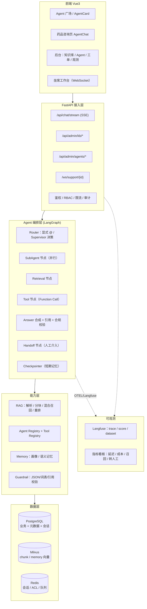
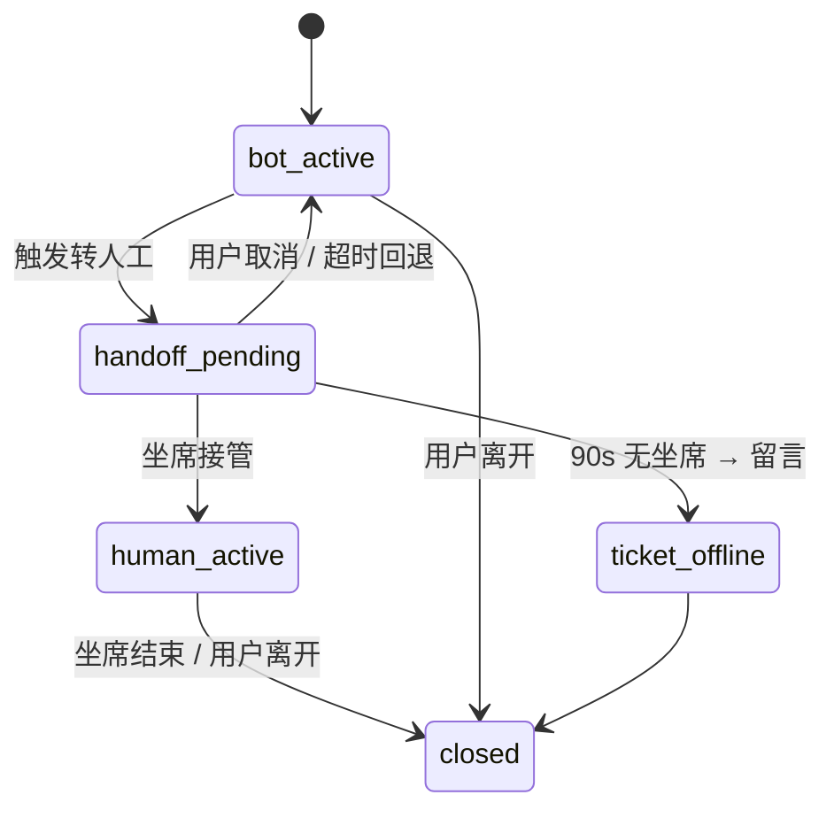
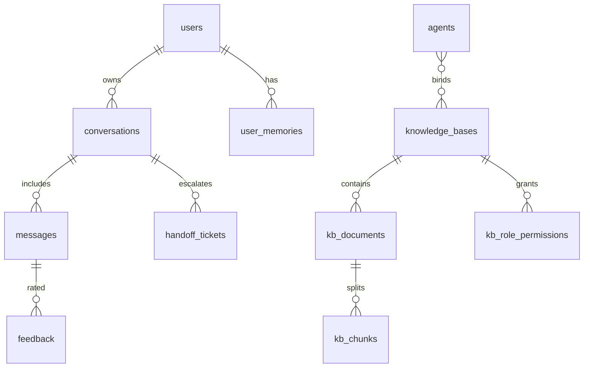
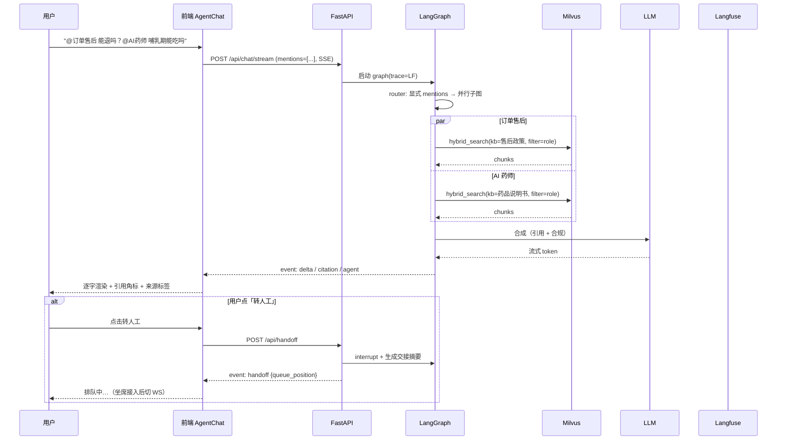

# 花红 Agent 应用平台 · 需求文档（PRD）

> **一句话定位**：以「多 Agent 协作 + 可管理的 RAG + 全链路可观测 + 可转人工」为主线的工程化 Agent 平台 MVP，同时作为投递花红药业「Agent 应用开发」岗位的求职作品。

| 项 | 内容 |
| --- | --- |
| 项目代号 | HHAgent（花红 Agent 平台） |
| 文档版本 | v1.0（评审稿） |
| 编写日期 | 2026-11-18 |
| 对应岗位 | Agent 工作流 / 大模型应用 / RAG 知识库问答（见 [jd.md](../jd.md)） |
| 业务参考 | 花红药业官网 <https://hhyy.com>（企业简介、企业文化、花红产品、联系花红等栏目） |
| 文档状态 | 待评审 → 评审通过后拆分为迭代任务（已完成拆分：[任务清单.md](任务清单.md)） |
| 读者 | 本人（开发者）、面试官/技术评审、潜在业务方 |

**目录**

0. [作品亮点速览（30 秒版）](#0-作品亮点速览30-秒版)
1. [背景与目标](#1-背景与目标)
2. [现状盘点（基于代码）](#2-现状盘点基于代码)
3. [角色与权限模型](#3-角色与权限模型)
4. [总体架构](#4-总体架构)
5. [功能需求](#5-功能需求)
6. [数据模型](#6-数据模型)
7. [API 设计](#7-api-设计)
8. [前端交互设计](#8-前端交互设计)
9. [非功能需求](#9-非功能需求)
10. [里程碑与排期](#10-里程碑与排期)
11. [验收标准与演示脚本](#11-验收标准与演示脚本)
12. [风险与对策](#12-风险与对策)
13. [附录](#13-附录)

---

## 0. 作品亮点速览（30 秒版）

1. **知识库是数据，不是代码**：后台建库、传文档、配权限，新增业务场景不需要发版（F2）。
2. **权限下推到检索层**：`expr = kb_id in (有权的库) and status='published'`，不是先召回后过滤（§3.2）。
3. **Agent 是配置，工具是代码**：Agent = prompt + 模型 + 知识库 + 工具 + 权限，前端即卡片/组件（F1、F4.8）。
4. **`@` 多 Agent 真并行**：一条消息同时问药品与订单，结论分来源标注，同一 trace 下两个 span（F4）。
5. **能兜底**：低分拒答、合规拦截、转人工闭环、跨会话记忆（F5、F6、F8）。
6. **能度量**：Langfuse 全链路 trace + golden set 评估 + 指标看板，改动可回归（F7）。

> 面试现场直接翻到 §11.2 的 8 分钟演示脚本。

---

## 1. 背景与目标

### 1.1 求职背景

目标岗位要求覆盖六块能力：**Agent 工作流设计（ReAct / Function Call）、RAG 全链路建设与评估、Prompt 工程与输出治理、架构选型与组件沉淀、自动化测试与稳定性、业务沟通**，加分项是**医药/高监管行业经验**与**从 0 到 1 搭建 RAG/Agent**。

因此这个作品不能停在「一个大模型接口 + 一段 prompt」，必须能现场回答三个问题：

1. 你的 RAG 除了「向量检索 + 拼 prompt」，还做了什么？（分块策略、混合召回、重排、阈值拒答、引用溯源、离线评估）
2. 你的 Agent 是「写死的」，还是「可配置、可扩展、可观测」的？（注册中心、工具协议、多 Agent 路由、trace）
3. 出问题时你怎么知道、怎么定位、怎么修？（Langfuse trace、评估集、回归门禁、幻觉兜底）

文档本身就是第 6 条「业务沟通与技术预研」的交付物。

### 1.2 业务背景（官网调研摘要）

花红药业集团是集药材种植、科研、生产、销售于一体的国家重点中成药企业，始建于 20 世纪 70 年代初，定位「高品质科技中成药企业」，品牌使命「关爱生命健康 守护家庭幸福」，业务重心在**女性健康/妇科用药**，并已在京东、天猫开设旗舰店，官网持有《互联网药品信息服务资格证书》。

对本项目的影响：

- **知识库形态确定**：企业介绍（公开可讲）/ 药品说明书（强监管、需谨慎）/ 订单售后政策（内部规则）/ 客服 SOP（内部）。
- **合规是硬约束而非装饰**：药品说明书、疗效表述、处方药信息受《广告法》《药品管理法》《互联网药品信息服务管理办法》约束，因此必须有**输出治理 + 知识库分级权限 + 审计留痕**，这也是加分项「高监管领域 AI 应用」「可审计、合规」的落点。
- **用户画像清晰**：C 端患者（女性健康、慢病用药）、B 端门店/经销商，以及内部客服坐席——决定了「患者咨询」与「坐席辅助」两条 Agent 主线。

> 说明：本文档中的业务流程、数据与规则均为**作品演示用途的设计**，不代表花红药业真实系统；涉企业信息均取自官网公开内容。

### 1.3 产品定位

一个**可独立运行、可现场演示、可讲清设计取舍**的全栈 Agent 平台：

- 前台：企业官网风格的 Agent 广场 + 药品咨询页 + 客服会话（含 `@` 多 Agent 与转人工）。
- 后台：知识库管理（多库、多格式、权限、检索测试）、Agent 管理（卡片、prompt、工具绑定）、会话与工单、评估与观测看板。
- 底座：统一 Agent Runtime（LangGraph）、Milvus 检索层、Langfuse 可观测、记忆系统。

### 1.4 目标（MoSCoW）

| 级别 | 目标 | 验收方式 |
| --- | --- | --- |
| **Must** | 后台可增删改知识库、上传文档、配置「知识库 × 角色」权限，且**非硬编码** | 现场新建一个知识库并让某个 Agent 用上 |
| **Must** | RAG 走 Milvus，含分块、混合召回、重排、阈值拒答、引用溯源 | 回答中可点开原文片段 |
| **Must** | 多 Agent：Agent 注册为「卡片/组件」，药品咨询页主 Agent 可 `@` 其他 Agent 回答 | 一条消息同时 `@` 药品 + 订单两个 Agent |
| **Must** | 转人工：触发 → 排队 → 坐席接管 → 结束，AI 静默 | 坐席端实时看到并回复 |
| **Must** | Langfuse 全链路 trace（检索/LLM/工具/转人工），带 token 与成本 | 打开 Langfuse 看到完整 trace 树 |
| **Must** | 记忆：同一用户跨会话记住关键事实（过敏史、常购药品） | 第二次会话主动提及并说明来源 |
| **Should** | 评估：golden set ≥ 50 条，指标可见，prompt 改动可回归 | 跑一次评估给出 recall@5 / faithfulness |
| **Should** | 输出治理：JSON 校验、分类白名单、合规词表、免责声明 | 输入「这药能根治吗」被正确拒答/改写 |
| **Could** | 语义缓存、Prompt 灰度 A/B、知识库零召回看板、语音输入 | 视时间取舍 |

### 1.5 非目标（本期不做）

- 真实支付/物流对接、真实坐席排班与质检、多租户 SaaS 化、模型微调（SFT/LoRA）、自建向量库、复杂权限的字段级脱敏引擎、多模态（图片/处方单识别）。
- 不追求生产级并发（目标 50 并发以内），但要给出扩展路径。

---

## 2. 现状盘点（基于代码）

> 盘点方式：CodeGraph 索引（`.codegraph/`）+ 源码核对，非臆测。

### 2.1 已具备能力

| 能力 | 实现位置 | 成熟度 |
| --- | --- | --- |
| 全栈骨架 | FastAPI + SQLAlchemy(async) + PostgreSQL/pgvector + Redis + Vue3/Vant/Pinia | ✅ 可用 |
| RBAC | [deps.py](../backend/app/api/deps.py) `require_roles` + 前端 `v-permission` 指令 | 🟡 仅功能级 |
| 药品 CRUD | [product.py](../backend/app/api/product.py) | ✅ 可用 |
| 购物车/订单 | `api/cart.py`、`api/order.py`、订单状态机 | ✅ 可用 |
| **药品入库 Agent** | [agent.py](../backend/app/api/agent.py)：自然语言 → 结构化 JSON（`JsonOutputParser` + `AgentProductParse`） | 🟡 单次调用，无校验闭环 |
| **药品咨询 Agent** | [agent_drug.py](../backend/app/api/agent_drug.py)：把药品说明书整段塞进 system prompt | 🟠 **伪 RAG**（无检索、无分块、无引用） |
| Milvus 封装 | [vector_store.py](../backend/app/services/vector_store.py)：`add_documents` / `search_documents` | 🟠 无调用方、无元数据、无过滤 |
| 前端 AI 组件 | `AgentInput.vue`（一键解析填表）、`DrugAIAssistant.vue`（对话卡片） | 🟡 各自实现，未抽象 |
| 配置 | [config.py](../backend/app/core/config.py) 已含 DeepSeek / DashScope / **Langfuse** / Milvus 变量 | ✅ 变量齐备 |

### 2.2 技术栈

后端：FastAPI、SQLAlchemy 2.0 async、PostgreSQL 16 + pgvector、Redis 7、Milvus（standalone + etcd + MinIO）、LangChain 1.x、**LangGraph 1.x（已装未用）**、langchain-milvus、pymilvus、langfuse SDK（已装未接）。
模型：DeepSeek Chat（`deepseek-flash`）+ DashScope `text-embedding-v4`（1024 维）。
前端：Vue 3.5 + Vite + Vant 4 + Pinia + Vue Router + marked + lucide-vue-next。

### 2.3 差距与缺陷清单

> 编号用于后续任务拆分；「证据」均可在仓库中定位到行。

| 编号 | 问题 | 证据 | 影响 | 处置 |
| --- | --- | --- | --- | --- |
| **G1** | 无真实 RAG 检索链路 | [agent_drug.py:41-54](../backend/app/api/agent_drug.py) 直接字符串拼说明书 | 换药品就失效，无法跨文档、无法回答「企业介绍」「售后政策」 | F3 全链路重建 |
| **G2** | 知识库不存在实体，只有 `collection_name: str` | [vector_store.py:7,17](../backend/app/services/vector_store.py) | 无法后台管理、无法授权、无法统计 | F2 + 新增 `knowledge_bases` 等表 |
| **G3** | 无知识库级权限 | [deps.py](../backend/app/api/deps.py) 只有角色枚举 | 患者可能检索到内部 SOP/进货价 | F2 §权限 + 检索层过滤 |
| **G4** | Langfuse 仅存在于配置 | [config.py:29-31](../backend/app/core/config.py)，全仓无 `langfuse` 调用 | 无法定位「为什么答错」、无成本视图 | F7 |
| **G5** | 无记忆，`session_id` 被丢弃 | [agent_chat.py:9](../backend/app/schemas/agent_chat.py) 定义 `session_id`，[agent_drug.py:19-23](../backend/app/api/agent_drug.py) 未使用 | 多轮指代失败（「那孕妇呢？」） | F6 |
| **G6** | 无 Agent 抽象 | 两个 API 各自内联 `ChatOpenAI` 与 prompt | 新增 Agent 需复制粘贴，无法卡片化 | F1 |
| **G7** | 无流式输出 | 全部 `invoke` 一次性返回 | 首字延迟 5s+，演示体验差 | F1.6 / SSE |
| **G8** | **缺陷**：`settings.deepseek_model` 不存在 | [client.py:12](../backend/app/llm/client.py) vs [config.py:20](../backend/app/core/config.py) `deepseek_chat_model` | 一旦启用该工厂即 `AttributeError` | 修复 + 统一走工厂 |
| **G9** | **缺陷**：路由守卫只校验 `meta.roles`，忽略 `meta.role` | [router/index.js:70-86](../frontend/src/router/index.js)（尤其 :79） vs `meta: {role:'admin'}` | 任意登录用户可直接访问 `/admin`、`/doctor` | 修复守卫 |
| **G10** | 无任何测试 | `pytest.ini` 存在，无 `test_*.py` | 无法证明「质量保障」 | §9.3 测试金字塔 + CI |
| **G11** | `embedding` 列从未写入 | [product.py:33](../backend/app/models/product.py) | 冗余 schema，误导架构理解 | 迁移中移除或改由 Milvus 承载 |
| **G12** | 无结构化输出校验/重试 | `JsonOutputParser` 直接 `invoke` | 模型偶发字段缺失即整体失败 | F8.4 |
| **G13** | 前端 AI 能力零散 | `AgentInput.vue` / `DrugAIAssistant.vue` 各写 loading、消息、滚动 | 无法复用、无法支持 `@` 与转人工 | F9 组件库 |
| **G14** | 无审计与合规治理 | 全仓无敏感词/免责声明/日志 | 医药场景硬伤（面试必问） | F8.5 |
| **G15** | 无数据库迁移 | 依赖 `script/init_db.py` 的 `create_all`，`alembic` 已在依赖但未初始化 | 加表即「手工改库」 | 初始化 Alembic |

### 2.4 改造原则

1. **不推倒重来**：`/api/agent/parse-product`、`/api/agent/drug-consult` 对外契约保持兼容，前端现有页面不返工（内部替换实现）。
2. **先抽象后堆功能**：先有 Agent Runtime + Tool 协议 + 检索层接口，再上多 Agent、记忆、转人工，避免二次重构。
3. **每个能力都要有「可观测出口」**：新增功能必须同时产出 trace / 指标 / 测试，否则不计入完成。

---

## 3. 角色与权限模型

### 3.1 角色定义

| 角色 | 枚举值 | 来源 | 说明 |
| --- | --- | --- | --- |
| 游客 | `visitor` | 未登录（虚拟角色） | 只读公开知识，可咨询但不可查订单 |
| 患者 | `patient` | 现有 `UserRole.PATIENT` | C 端用户，可查本人订单 |
| 医生 | `doctor` | 现有 `UserRole.DOCTOR` | 可录入药品、查看专业版说明书 |
| 客服坐席 | `support` | **新增** | 可接管会话、查订单售后知识库 |
| 管理员 | `admin` | 现有 `UserRole.ADMIN` | 管理知识库、Agent、权限、查看全部会话 |

> `UserRole` 需新增 `SUPPORT = "support"`；前端 `roleColorMap / roleNameMap / 快捷切换账号` 同步；用 Alembic 迁移（PG 枚举需 `ALTER TYPE ... ADD VALUE`）。

### 3.2 两层权限模型

- **功能权限（RBAC）**：能不能进后台、能不能调某个 Agent、能不能接管会话 —— 后端 `Depends(require_roles(...))`，前端路由/指令仅做体验。
- **数据权限（KB ACL）**：这次检索**能召回哪些知识库的 chunk** —— 在向量检索的 `expr` 里做，而非「先召回再过滤」。

**两条铁律**

1. **默认拒绝**：新建知识库默认 `visibility=private`、无任何角色授权，必须显式授权才可被检索。
2. **过滤下推到检索层**：`expr = kb_id in [allowed...] and status == "published" and effective_to > now`。先召回后过滤会导致「召回 5 条全是无权限数据 → 答不出」或「信息泄露」。

### 3.3 权限矩阵（初始配置）

| 知识库 | visitor | patient | doctor | support | admin |
| --- | --- | --- | --- | --- | --- |
| 企业介绍 / 品牌故事 | ✅ | ✅ | ✅ | ✅ | ✅ |
| 药品说明书（公开部分） | ❌ | ✅ | ✅ | ✅ | ✅ |
| 药品说明书（专业/处方信息） | ❌ | ❌ | ✅ | 🟡 只读 | ✅ |
| 订单与售后政策 | ❌ | 🟡 仅本人订单规则 | ✅ | ✅ | ✅ |
| 客服 SOP / 话术库 | ❌ | ❌ | ❌ | ✅ | ✅ |
| 内部经营/价格策略 | ❌ | ❌ | ❌ | ❌ | ✅ |

### 3.4 一致性要求

- 权限变更后 **≤30s 生效**（Redis 缓存 `acl:{user_id}`，写操作主动失效）。
- 无权限时统一返回「空召回 + 通用话术」，**不暴露知识库是否存在**（防枚举）。
- 后台所有知识库/权限变更写入 `audit_logs`（谁、何时、改了什么、前后值）。
- 坐席查看用户订单必须校验 `order.user_id == current_user.id` 或角色为 support/admin（防止越权查单）。

---

## 4. 总体架构

### 4.1 架构图



### 4.2 分层职责

| 层 | 职责 | 不允许做的事 |
| --- | --- | --- |
| 接入层 | 鉴权、参数校验、限流、SSE 编码、审计埋点 | 不写 prompt、不直连向量库 |
| 编排层 | 决定「谁回答、查什么、调什么工具、何时转人工」 | 不拼 SQL、不处理 HTTP |
| 能力层 | 可复用原子能力（检索、记忆、校验、工具） | 不感知用户身份的具体值（只接收 role/kb_ids） |
| 数据层 | 持久化与检索 | 不含业务判断 |

### 4.3 关键设计决策（ADR）

| 编号 | 决策 | 备选与放弃原因 | 代价/风险 |
| --- | --- | --- | --- |
| ADR-1 | **LangGraph 状态图 + Supervisor 路由** | 纯 ReAct 循环（不可控、易死循环、难插人工节点）；Dify 低代码（演示性强但代码深度不足以证明工程能力） | 学习成本；需自行处理并行与超时 |
| ADR-2 | **单 Milvus collection + `kb_id` 标量分区** | 每库一 collection：隔离强但跨库检索要多次查询、新建库需建表、数量膨胀后运维困难 | 需保证每次检索都带 `kb_id` 过滤（用 repository 强制封装） |
| ADR-3 | **权限过滤下推到向量检索 expr** | 应用层过滤：召回不足、易泄露 | expr 复杂度上升，需为 `kb_id` 建标量索引 |
| ADR-4 | **短期记忆用 LangGraph checkpointer(Postgres)，长期用「结构化画像 + 语义记忆 collection」** | 仅存聊天记录：无法跨会话；仅向量：不可解释、易漂移 | 写入需抽取与去重，成本可控但需异步 |
| ADR-5 | **对话流式用 SSE；WebSocket 只用于人工坐席** | 全 WS：鉴权与断线重连复杂；全 HTTP：无流式体验 | SSE 不能带自定义 header → 用短期 ticket 或 cookie |
| ADR-6 | **Agent 是配置，工具是代码** | Agent 也写代码：新增 Agent 要发版 | 配置错误需校验（保存时 schema 校验 + 试跑） |
| ADR-7 | **RAG 检索不走 langchain-milvus 的高级封装，自建 `MilvusRepo`（pymilvus）** | 封装对 schema、索引参数、混合检索、复杂 filter 的可控性不足；BM25 需自定义 Function 与 Sparse 字段 | 需自己写 schema 与混合检索，代码量增加但可控可讲 |

---

## 5. 功能需求

> 优先级：P0 = MVP 必须；P1 = 时间允许则做；P2 = 加分/后续。
> 验收标准尽量写成可执行的「给定/当/则」。

### F1 统一 Agent 运行时与注册中心（P0）

**FR1.1 Agent 定义（DB 化）**

```jsonc
{
  "code": "drug_consult",            // 唯一标识，代码中引用
  "name": "AI 药师",
  "avatar": "/static/agents/drug.png",
  "description": "基于药品说明书回答用法用量、禁忌、不良反应",
  "system_prompt_code": "drug_consult",   // 关联 prompt_templates
  "model": "deepseek-flash",
  "temperature": 0.3,
  "kb_ids": ["kb_drug_manual"],       // 绑定知识库
  "tools": ["kb_search", "product_lookup", "escalate_human"],
  "allowed_roles": ["patient", "doctor", "support", "admin"],
  "handoff_targets": ["order_after_sale", "human_support"],
  "ui_mode": "chat",                  // chat | inline | form
  "status": "active"
}
```

**FR1.2 工具注册表（代码侧）**

- `@register_tool` 装饰器统一注册，声明 `name / description / args_schema / required_roles / timeout`，自动生成 Function Calling schema。
- MVP 工具清单：

| 工具 | 作用 | 权限 | 备注 |
| --- | --- | --- | --- |
| `kb_search` | 检索指定知识库 | 继承调用者 | 入参：query、kb_ids、top_k |
| `product_lookup` | 按名称/ID 查药品 | 所有 | 结构化数据，非向量 |
| `order_lookup` | 查订单与物流 | patient(本人)/support | **必须校验归属** |
| `policy_search` | 查售后政策 | 所有 | 本质是 kb_search 快捷封装 |
| `remember` | 写入记忆 | 登录用户 | 需二次确认或显式指令 |
| `escalate_human` | 转人工 | 所有 | 生成工单 + 中断图 |
| `compliance_check` | 输出合规校验 | 内部 | 非 LLM 工具，规则引擎 |

**FR1.3 运行时入口**：`POST /api/chat/stream`（SSE），入参 `{conversation_id?, agent_code, message, mentions[], context{product_id?, order_id?}}`。

**FR1.4 路由决策**

- 有 `mentions` → **显式路由**（不消耗 LLM 判断，可靠、可解释），直接并行调对应子 Agent。
- 无 `mentions` → **Supervisor 决策**：LLM 结构化输出 `{agents:[], rationale, confidence}`；`confidence < 0.6` 时先澄清一句或直接给出「转人工」选项。
- 子 Agent 之间允许 **handoff 一次**（A 判断应由 B 回答），带 `handoff_count` 防止循环。

**FR1.5 输出契约**

```jsonc
{
  "message_id": "…",
  "answer": "…[1]…[2]",
  "agent": {"code": "drug_consult", "name": "AI 药师"},
  "contributors": [{"code": "order_after_sale", "summary": "…"}],
  "citations": [{"index": 1, "doc_title": "花红片说明书", "section": "禁忌", "page": 2, "snippet": "…", "url": "…"}],
  "suggested_actions": [{"type": "handoff", "label": "转人工客服"}],
  "handoff": null,
  "guardrail": {"passed": true, "flags": []},
  "trace_id": "…"
}
```

**FR1.6 流式**：SSE 事件协议见 §7.2；首字延迟（TTFT）目标 ≤ 1.5s。

**FR1.7 降级**：子 Agent 超时 **8s** → 主 Agent 用已得结果作答，并注明「订单信息暂时未取到」。LLM 主模型失败 → 切换备用模型（同协议不同 provider）一次。

**FR1.8 幂等**：同一 `client_message_id` 5 分钟内重复提交返回原结果，避免用户连点产生双份扣费。

**验收**：后台新增一个 Agent（不写代码、只配置 + 选工具 + 绑知识库）后，前台 Agent 广场立刻出现卡片并可对话。

---

### F2 知识库管理（P0，作品核心卖点之一）

**FR2.1 知识库 CRUD**

| 字段 | 说明 |
| --- | --- |
| `code` / `name` / `description` | 唯一编码、展示名、用途说明 |
| `embedding_model` / `dim` | 默认 `text-embedding-v4` / 1024 |
| `chunk_strategy` | `structured`（说明书按小节）/ `recursive`（512 字，64 重叠） |
| `rerank_enabled` / `score_threshold` | 是否重排；`score_threshold` 是**余弦口径**阈值，重排路径用全局 `RERANK_SCORE_THRESHOLD` |
| `visibility` | `private` / `public`（public 即对 visitor 开放） |
| `status` | `draft` / `active` / `archived`（归档后不可检索，数据保留） |

**FR2.2 文档接入**

- 支持 `pdf / docx / md / txt`，以及「官网 URL 抓取」（用于企业介绍）。
- 单文件 ≤ 20MB，中文编码自动识别；扫描件提示「需 OCR（本期不支持）」。
- 解析状态机：`pending → parsing → chunking → embedding → ready | failed`，失败保留原因可重试。

**FR2.3 文档管理**：列表（状态、chunk 数、更新时间、上传人）、重新解析、启用/停用、删除（**级联删除 Milvus 向量**，先删向量再删元数据，失败可补偿）。

**FR2.4 分段可视化编辑**：查看 chunk 列表（含 `section` 标签、字数、命中次数），支持手改正文并「仅重建该 chunk 向量」。

> 面试点：说明书按 `【成份】【功能主治】【用法用量】【禁忌】` 切分，检索「孕妇能吃吗」时能精准命中「禁忌/孕妇及哺乳期妇女禁用」段落，而不是命中整篇说明书。

**FR2.5 权限配置**：矩阵勾选（知识库 × 角色），保存即写 `kb_role_permissions` 并失效 Redis 缓存。**未授权 = 拒绝**。

**FR2.6 检索测试台（强烈建议做，演示效果最好）**

- 输入 query → 展示：过滤掉的库、召回 chunk 列表（分数、来源、section）、重排前后对比、最终拼进 prompt 的上下文。
- 支持「以某角色身份测试」（如以 patient 测试，验证内部 SOP 不出现）。

**FR2.7 统计**：文档数、chunk 数、7 日检索次数、**零召回 query 榜单**（直接指导补文档）。

**FR2.8 审计**：所有写操作入 `audit_logs`（actor、action、target、before/after、ip、时间）。

**验收**：给定管理员在后台新建「订单售后政策」知识库并只授权 patient/support，当患者提问「七天无理由退货吗」，则回答引用该知识库原文；当游客提出同一问题，则不出现该知识库内容。

---

### F3 RAG 检索链路（P0）

**FR3.1 解析（Parsing）**：PDF → 文本（保留标题层级/页码）；DOCX → 段落；HTML → 正文抽取（去导航/页脚）。产出 `{text, sections[], page_map}`。

**FR3.2 分块（Chunking）**

- `structured`：识别 `【xx】`、`一、二、`、`1.1` 等标题模式，**按小节切**，超长小节再按 512/64 递归切；每个 chunk 携带 `section`。
- `recursive`：RecursiveCharacterTextSplitter，中文分隔符 `["\n\n","\n","。","；","，"]`。
- 表格/列表保持完整，不跨表切分。
- chunk 上限 800 字，过短（<50 字）与相邻 chunk 合并。

**FR3.3 写入（Indexing）**：Milvus collection `hhyy_kb_chunks`，字段见 §6.3；批量 100 条/次，带重试与断点续传（记录 `last_indexed_offset`）。

**FR3.4 召回（Retrieval）**

```
query
 ├─ 多轮改写（有历史时消解指代："那孕妇呢" → "花红片 孕妇 禁忌"）
 ├─ dense: text-embedding-v4 → top 30
 ├─ sparse: BM25（Milvus Full-Text / Sparse） → top 30
 ├─ RRF 融合（k=60）
 ├─ rerank（gte-rerank-v2）→ top 20 → 截断 top 5
 ├─ 阈值判定：top1 < 阈值 → 拒答（口径决定阈值，见下）
 └─ 权限过滤 expr（kb_id / status / 生效期）在每次 search 内
```

**阈值按分数口径分开**（同量纲 ≠ 同分布，实测两套刻度差一个数量级）：

| 打分口径 | 阈值 | 依据 |
| --- | --- | --- |
| 重排分（正常路径） | `RERANK_SCORE_THRESHOLD=0.15` | 实测 10 正 / 10 负问题：负例最高 0.135、正例最低 0.175 |
| 余弦相似度（重排不可用时降级） | 库级 `score_threshold`（0.35/0.40） | 余弦对泛问句偏低、对无关问题偏高，只能按库标定 |

用一套阈值卡两种分数，必然一边全拒（重排分被 0.30 卡死）、一边全放（余弦 0.69 的无关问题）。

> 已知局限：重排分在 0.13~0.19 之间有一小段「弱相关」重叠区（如「医保能报销吗」0.135 vs
> 「怎么退款」0.175），单靠阈值无法完全分开。越界问题由生成层的「资料里没有就说没有」兜住；
> 彻底解决要靠 M4 的 LLM 判定 / 离线评估集，不在 M1 范围内。

**FR3.5 上下文组装**：`[1]（《花红片说明书》·禁忌）…`，总 token 上限 2500，超限按分数截断并保留至少 2 条。

**FR3.6 引用溯源**：每条引用回到 `doc_id + chunk_index`，回答中的 `[n]` 与 `citations[n]` 一一对应；**校验引用真实性**（回答出现的 `[n]` 必须在 citations 范围内，否则降级去掉标记）。

**FR3.7 拒答策略**：无召回 / 分数低 / 问题涉及诊断与处方 → 统一话术 + 建议就医 + 提供转人工入口；**绝不编造**。

**FR3.8 评估（P1）**

- golden set 50 条（问题 / 期望召回文档 / 标准答案要点 / 是否应拒答）。
- 指标：`recall@5`、`MRR`、`faithfulness`、`citation_precision`、`refusal_accuracy`。
- 执行：脚本 + `pytest -m eval`（nightly），结果写 Langfuse dataset run，与上一次对比（回归门禁：faithfulness 下降 >5% 报警）。

**FR3.9 缓存（P2）**：query 语义缓存（embedding 相似度 >0.95 命中），TTL 1h，权限维度参与 key。

**验收**：对「哺乳期可以吃花红片吗」类问题，回答含引用且引用段落确实包含「哺乳期」；对「今天股市怎么样」拒答且不产生引用。

---

### F4 多 Agent 协作与 `@` 调用（P0，作品差异化）

**FR4.1 交互**：输入框键入 `@` 弹出候选（按当前用户权限过滤），显示头像/名称/一句话能力；支持 `↑↓` 选择、`Enter/Tab` 确认、`Esc` 关闭；中文输入法组合态不误触发；`@` 后继续输入文本。

**FR4.2 数据契约**：前端解析出 `mentions: [{agent_code, name, offset}]` 随消息提交；**后端不解析文本找 `@`**（避免名字歧义、注入、被动信任前端排序）。

**FR4.3 单 `@`**：被 `@` 的 Agent 为「主答」，其绑定知识库/工具限定；当前页主 Agent 保留「组织语言」职责（`ui_mode=chat` 时直答以省 token）。

**FR4.4 多 `@`**：并行执行（`asyncio.gather`，独立超时 8s）→ 汇总节点按「结论 + 来源 Agent」融合，冲突时并列陈述并标注不确定。

**FR4.5 权限**：候选列表过滤；伪造 `agent_code` → 400；无权限工具调用 → 工具层拒绝并回传 `guardrail.flag`。

**FR4.6 可见性**：回答气泡显示贡献 Agent 标签；点「查看依据」展开该 Agent 的检索片段与工具调用（trace 子集），既透明又便于演示可观测。

**FR4.7 示例**（药品详情页）：

> 用户：`@订单售后 我刚买的这单能退吗？` `@AI药师 这个药能和布洛芬一起吃吗？`

输出：两段结论分别标注来源，末尾给出「合并建议」。

**FR4.8 Agent 卡片/组件化**

- 数据：`GET /api/agents?visible=1` 返回卡片列表（含 `ui_mode`、`entry`）。
- 前端组件：`<AgentCard>`（广场/首页）、`<AgentChat :agent-code>`（通用对话）、`<AgentInput>`（内嵌式，升级版）、`<MentionInput>`。
- 后端「组件化」：一个 Agent = 配置 + 绑定的工具集 + 知识库集，注册表在代码里只是工具与节点，Agent 本身零代码。

**验收**：一条消息同时 `@` 两个 Agent，返回两段带来源标注的答案，且 Langfuse 中可见同一 trace 下的两个并行 span。

---

### F5 人工介入与转人工（P0）

**FR5.1 触发条件**

| 类型 | 触发条件 | 行为 |
| --- | --- | --- |
| 显式 | 用户点击「转人工」 | 直接建单排队 |
| 模型自决 | `escalate_human` 工具调用 | 生成交接摘要后排队 |
| 兜底 | 连续 2 次拒答/无召回 | 主动建议转人工 |
| 敏感 | 投诉、用药过量、自杀倾向、医疗纠纷、要求赔偿 | **立即转人工**，同时打风险标记 |
| 情绪 | 负面情绪连续 2 轮 | 建议转人工（不强转） |

**FR5.2 会话状态机**



**FR5.3 排队与超时**：返回排队位次与预计等待；90s 无人接管 → 引导留言表单（姓名、联系方式、诉求）生成离线工单。

**FR5.4 坐席工作台**（`/support`，角色 support/admin）

- 待接入列表（等待时长、用户标签、风险标记）、我的会话。
- 会话详情：用户消息 + AI 历史 + **AI 交接摘要**（诉求 / 已尝试 / 关键信息 / 建议话术）+ 记忆画像。
- 操作：接管、发送消息、常用语、转其他技能组、结束会话、打标签。

**FR5.5 通道**：`/ws/support/{conversation_id}`，Redis Pub/Sub 跨进程广播；人工接管后 AI 静默（只记录不发言），用户消息不再进 LLM。

**FR5.6 交接摘要**（结构化，非长文本）：`{intent, entities, tried_steps, unresolved, risk_flags, suggested_reply}`，由 LLM 生成并写 `handoff_tickets.summary`。

**FR5.7 闭环**：结束后生成标签 + 满意度评价；该会话进入「评估集候选池」，人工标注后可回流 golden set。

**FR5.8 离线兜底（P1）**：非工作时间提示服务时间 + 留言，次日坐席跟进。

**验收**：患者在药品页点「转人工」→ 坐席端 3s 内出现待接入 → 接管后双向消息实时可见 → AI 不再回复 → 结束后工单留存摘要。

---

### F6 记忆系统（P0）

**FR6.1 短期记忆**

- `thread_id = conversation_id`，LangGraph `AsyncPostgresSaver` 持久化。
- 上下文窗口：最近 10 轮原文 + 超出部分滚动摘要（`summary` 字段），总 token 预算 1500。

**FR6.2 长期结构化画像**（`user_profiles` + `user_memories`）

| 类型 | 示例 | 来源 | 生命周期 |
| --- | --- | --- | --- |
| 事实 `fact` | 「对青霉素过敏」 | 用户自述 | 长期（可删） |
| 偏好 `preference` | 「偏好颗粒剂」「希望电话联系」 | 行为/自述 | 长期 |
| 情节 `episode` | 「2026-11 咨询过花红片哺乳期用药」 | 会话摘要 | 180 天 |
| 禁忌 `risk` | 「孕早期」 | 自述（高敏感） | 加密 + 强提示 |

**FR6.3 语义记忆**：Milvus collection `hhyy_memory`，字段 `user_id / type / content / embedding / created_at / expires_at / source_message_id`；检索时 `user_id == current` 强制过滤。

**FR6.4 写入策略**（异步，不阻塞回答）

1. 会话结束或每 6 轮触发抽取 → LLM 输出候选 `{type, content, confidence, sensitive}`。
2. 规则过滤：手机号/身份证/地址 → 脱敏或拒写；`sensitive=true` 需用户确认。
3. 去重：与已有记忆相似度 > 0.95 则更新 `updated_at` 而非新增。
4. 显式指令「记住…」→ 立即写入并回执「已记住」。

**FR6.5 读取与注入**：画像（≤300 token，含「上次提到」）+ 语义记忆 top 3（按相似度 × 时间衰减）；在回答中**可解释**地使用：「您上次提到对青霉素过敏，这款药不含青霉素类成分」。

**FR6.6 用户可控（合规必需）**：`/me/memory` 页面查看、单条删除、一键关闭记忆；关闭后不再写入（历史保留可删）。

**FR6.7 隔离**：记忆永不跨用户；管理员仅可见统计（条数/类型分布），不可读正文。

**验收**：会话 A 中用户说「我对青霉素过敏」→ 会话 B 问「这个药我能吃吗」→ 回答主动提及过敏史并给出依据；在「我的记忆」中可看到并删除该条。

---

### F7 可观测与评估（Langfuse，P0）

**FR7.1 接入**：应用启动初始化 Langfuse client（`public_key/secret_key/host` 来自配置，缺失则降级为 no-op）；LangGraph/LLM 调用通过 LangChain `CallbackHandler` 注入 `config.callbacks`；自研节点用 `@observe` 手动埋点。

**FR7.2 Trace 结构**

```
trace: chat.turn  (session_id=conversation_id, user_id, tags=[role, agent:xxx, kb:xxx])
├── span: router.decide          (mentions / supervisor, confidence)
├── span: retrieval              (kb_ids, expr, top_k, hits[].score, reranked)
├── span: subagent.drug_consult
│    ├── generation: llm         (model, prompt_version, tokens, cost)
│    └── span: tool.order_lookup
├── span: guardrail.check        (passed, flags)
└── span: handoff.escalate       (ticket_id, reason)
```

**FR7.3 元数据规范**：`user_id`、`session_id`、`tags`（`env`、`role`、`agent`、`kb_ids`）、`metadata.prompt_version`、`metadata.conversation_turn`。**统一命名**，否则看板无法聚合。

**FR7.4 评分**：用户 👍/👎 + 原因 → `score(name="user_feedback", value)`；系统自动分：`citation_present`、`refusal`、`handoff_triggered`、`latency_bucket`。

**FR7.5 数据集与实验**：golden set 上传为 Langfuse Dataset；每次 prompt/检索参数变更跑一次 run，对比 faithfulness、cost、latency。

**FR7.6 指标看板**

| 指标 | 目标 |
| --- | --- |
| TTFT p95 | ≤ 1.5s |
| 端到端 p95 | ≤ 6s |
| 检索 recall@5 | ≥ 0.85 |
| 引用准确率 | ≥ 0.90 |
| 拒答准确率 | ≥ 0.90 |
| 转人工率 | ≤ 15% |
| 单会话 token 成本 | ≤ ¥0.05（可用额度内） |
| 错误率 / 超时率 | ≤ 1% / ≤ 2% |

**FR7.7 脱敏**：上报前 mask 手机号/身份证/银行卡/地址（正则 + 可选 NER）；开关可配。

**FR7.8 可用性**：Langfuse 不可用时**不阻塞主链路**（异步批量 flush，失败丢弃并计数），仅在日志告警。

**验收**：一次提问在 Langfuse 中出现完整 trace，含检索命中片段与 token 成本；能按 `agent` 与 `kb` 过滤。

---

### F8 Prompt 工程与输出治理（P0/P1）

**FR8.1 模板库**：`prompt_templates(code, version, content, variables_schema, model, status, labels)`；代码中**不出现长 prompt 字符串**。

**FR8.2 变量校验与预览**：保存时用 `variables_schema` 校验占位符；后台可填样例变量渲染预览。

**FR8.3 版本与灰度**：`production` 标签指向当前版本；按 `hash(user_id) % 100 < rollout` 灰度；一键回滚。

**FR8.4 输出校验链（Guardrail）**

```
LLM 原始输出
 → ① JSON Schema 校验（结构化场景）→ 失败：带错误信息重试 ≤2 次（self-heal）
 → ② 业务规则（分类白名单、价格区间、批准文号正则 国药准字[A-Z]\d{8}）
 → ③ 合规词表（根治/治愈/无副作用/最有效/替代药物/包治…）→ 命中改写或拒答
 → ④ 引用存在性校验（[n] ⊆ citations）
 → ⑤ 免责声明注入（药品/健康类必带）
 → ⑥（可选）LLM Judge 复核
```

**FR8.5 医药合规专项**

- 禁止绝对化疗效承诺、禁止替代医生诊断、禁止推荐处方药给未确诊用户。
- 高危症状（胸痛、呼吸困难、大出血等）→ 强制「立即就医/拨打 120」话术并打断正常回答。
- 每屏输出底部保留「本回答仅为药品信息参考，不能替代医师诊断与处方」。
- 所有回答落库 `messages` 并可按 `trace_id` 回溯（可审计）。

**FR8.6 失败可观测**：每次校验失败上报 Langfuse `score(name="guardrail_violation", data_type="categorical")`，看板按类型聚合（指导 prompt 迭代）。

**验收**：输入「这药能根治咽炎吗」，输出不含「根治」，并给出合规表述 + 就医建议 + 免责声明。

---

### F9 前台消费端与组件库（P0）

**FR9.1 页面**

| 路由 | 页面 | 角色 | 说明 |
| --- | --- | --- | --- |
| `/agents` | Agent 广场 | 全 | 卡片列表，点击进入对话 |
| `/agents/:code` | 通用 Agent 对话页 | 全 | 复用 `AgentChat` |
| `/product/:id` | 药品详情（已有） | 全 | 内嵌 AI 药师 + `@` + 转人工 |
| `/service` | 客服中心（替换现有占位） | patient+ | 会话列表 / 新建会话 / 转人工状态 |
| `/support` | 坐席工作台 | support/admin | 待接入、会话、接管 |
| `/admin/kb` | 知识库管理 | admin | 列表、文档、检索测试台、权限 |
| `/admin/agents` | Agent 管理 | admin | 卡片、prompt、工具、知识库绑定 |
| `/admin/observe` | 观测与评估 | admin | 指标卡 + Langfuse 深链 + 评估结果 |
| `/me/memory` | 我的记忆 | 登录 | 查看/删除/关闭 |
| `/admin/tickets` | 工单 | support/admin | 排队、历史、标签 |

**FR9.2 组件清单（前端）**

`AgentCard` / `AgentChat` / `MentionInput` / `MessageList` / `MessageBubble`（含 Markdown、引用角标、Agent 署名）/ `CitationDrawer` / `HandoffBar` / `RetrievalPanel`（调试用）/ `TraceLink` / `useAgentChat`（composable：SSE 解析、重连、取消、乐观更新）。

**FR9.3 状态管理**：`useChatStore`（conversations、messages、streaming 状态、mentions 草稿）、`useAgentStore`（可见 Agent 列表，按角色缓存）、`useKbStore`（后台）。

**FR9.4 兼容**：`AgentInput`（药品录入）与 `DrugAIAssistant` 外观保持不变，内部改为调用新运行时与组件，保证已有页面视觉不回归。

**FR9.5 体验细节**：流式逐字、停止生成、失败重试、消息复制、引用可点、移动端安全区、暗色不做（省时间）。

---

### F10 药品入库 Agent 升级（P0，保留既有能力）

- **契约不变**：`POST /api/agent/parse-product` 仍返回 `data: {字段...}`。
- **内部改造**：走统一 runtime；新增工具 `category_whitelist`、`approval_number_check`（正则 + 校验位）、`product_duplicate_check`（同名/同批准文号）。
- **增强输出**：`{data, warnings:[], missing_fields:[]}`（前端对 `missing_fields` 高亮，`warnings` 以 toast 提示）。
- **Human-in-the-loop**：仍是「解析 → 表单确认 → 保存」，AI 不直接落库（符合医药数据可控要求）。
- **失败处理**：一次重试 + 错误反馈；连续失败给出「请手动填写」降级路径。
- **数据闭环**：人工修正后的差异写入 `eval_cases`，作为后续 prompt 优化的样本。

---

### F11 订单售后 Agent（P1，展示「工具 + 知识库 + 权限」组合）

- 工具：`order_lookup`（本人订单）、`policy_search`（售后政策 KB）、`logistics_lookup`（mock）、`create_ticket`。
- 规则：政策答案**必须引用知识库原文**；不得承诺赔付金额；涉及处方药退货 → 引用法规条款 + 转人工。
- 权限：只允许查询 `order.user_id == current_user.id`；support 可代查（留审计）。
- 与 F4 联动：在药品咨询页被 `@` 调用时，只返回「订单维度」结论，不重复药品知识。

---

## 6. 数据模型

### 6.1 新增/变更表（PostgreSQL）

```sql
-- 角色扩展（Alembic: ALTER TYPE userrole ADD VALUE 'support'）
-- 知识库
CREATE TABLE knowledge_bases (
  id            UUID PRIMARY KEY,
  code          VARCHAR(64) UNIQUE NOT NULL,
  name          VARCHAR(128) NOT NULL,
  description   TEXT,
  embedding_model VARCHAR(64) DEFAULT 'text-embedding-v4',
  dim           INT DEFAULT 1024,
  chunk_strategy VARCHAR(32) DEFAULT 'structured',
  rerank_enabled BOOLEAN DEFAULT true,
  score_threshold FLOAT DEFAULT 0.30,
  visibility    VARCHAR(16) DEFAULT 'private',   -- private | public
  status        VARCHAR(16) DEFAULT 'draft',
  owner_id      UUID REFERENCES users(id),
  created_at / updated_at TIMESTAMPTZ
);

-- 文档
CREATE TABLE kb_documents (
  id          UUID PRIMARY KEY,
  kb_id       UUID REFERENCES knowledge_bases(id) ON DELETE CASCADE,
  title       VARCHAR(255) NOT NULL,
  source_type VARCHAR(16),        -- pdf | docx | md | url | manual
  source_url  TEXT,
  file_path   TEXT,
  file_hash   VARCHAR(64),        -- 去重
  status      VARCHAR(16),        -- pending|parsing|chunking|embedding|ready|failed
  error_msg   TEXT,
  chunk_count INT DEFAULT 0,
  version     INT DEFAULT 1,
  last_indexed_offset INT DEFAULT 0,  -- 断点续传游标（M1-05 实现时补充）
  effective_from DATE, effective_to DATE,
  uploaded_by UUID REFERENCES users(id),
  created_at / updated_at TIMESTAMPTZ
);

-- 分段（正文留 PG 便于编辑与审计；向量在 Milvus）
CREATE TABLE kb_chunks (
  id          UUID PRIMARY KEY,
  doc_id      UUID REFERENCES kb_documents(id) ON DELETE CASCADE,
  kb_id       UUID NOT NULL,
  chunk_index INT NOT NULL,
  section     VARCHAR(128),
  content     TEXT NOT NULL,
  token_count INT,
  hit_count   INT DEFAULT 0,
  vector_id   VARCHAR(64),        -- Milvus 主键
  UNIQUE (doc_id, chunk_index)
);

-- 知识库 × 角色 授权
CREATE TABLE kb_role_permissions (
  kb_id  UUID REFERENCES knowledge_bases(id) ON DELETE CASCADE,
  role   VARCHAR(16) NOT NULL,
  can_read BOOLEAN DEFAULT true,
  PRIMARY KEY (kb_id, role)
);

-- 检索日志（M1-14 实现时补充：7 日检索次数与「零召回 query 榜」都依赖它）
CREATE TABLE kb_search_logs (
  id UUID PRIMARY KEY,
  query TEXT, query_norm VARCHAR(255),   -- 归一化后用于聚合
  kb_ids JSONB, role VARCHAR(16), actor_id UUID,
  hit_count INT, top_score FLOAT, refused BOOLEAN, reason VARCHAR(32),
  latency_ms INT, created_at TIMESTAMPTZ
);

-- Agent 注册
CREATE TABLE agents (
  id UUID PRIMARY KEY,
  code VARCHAR(64) UNIQUE NOT NULL,
  name VARCHAR(64), avatar TEXT, description TEXT,
  system_prompt_code VARCHAR(64),
  model VARCHAR(64), temperature FLOAT,
  kb_ids JSONB DEFAULT '[]',      -- 绑定知识库 code 列表
  tools JSONB DEFAULT '[]',
  allowed_roles JSONB DEFAULT '[]',
  handoff_targets JSONB DEFAULT '[]',
  ui_mode VARCHAR(16) DEFAULT 'chat',
  status VARCHAR(16) DEFAULT 'active',
  sort_order INT DEFAULT 0,
  created_at / updated_at
);

-- Prompt 模板
CREATE TABLE prompt_templates (
  id UUID PRIMARY KEY, code VARCHAR(64), version INT,
  content TEXT, variables_schema JSONB,
  model VARCHAR(64), status VARCHAR(16),   -- draft|testing|production|archived
  labels JSONB DEFAULT '[]', rollout INT DEFAULT 100,
  created_by UUID, created_at,
  UNIQUE (code, version)
);

-- 会话与消息
CREATE TABLE conversations (
  id UUID PRIMARY KEY,
  user_id UUID REFERENCES users(id),        -- 可空（游客）
  anonymous_id VARCHAR(64),
  agent_code VARCHAR(64),
  title VARCHAR(255),
  channel VARCHAR(16),                      -- web | product_page | support
  status VARCHAR(24),                       -- bot_active|handoff_pending|human_active|closed
  context JSONB DEFAULT '{}',               -- {product_id, order_id}
  created_at / updated_at
);

CREATE TABLE messages (
  id UUID PRIMARY KEY,
  conversation_id UUID REFERENCES conversations(id) ON DELETE CASCADE,
  role VARCHAR(16),                         -- user|assistant|system|human_agent|tool
  agent_code VARCHAR(64),
  content TEXT,
  mentions JSONB DEFAULT '[]',
  citations JSONB DEFAULT '[]',
  tool_calls JSONB DEFAULT '[]',
  contributors JSONB DEFAULT '[]',          -- M2 补充：多 Agent 贡献者（code/name/summary）
  client_message_id VARCHAR(64),            -- M2 补充：幂等键（FR1.8），建普通索引不建唯一键
  trace_id VARCHAR(64),
  latency_ms INT DEFAULT 0,                 -- M2 补充：首字/整轮耗时，前端可直接展示
  usage JSONB DEFAULT '{}',                 -- tokens / cost / latency
  created_at / updated_at
);

-- 转人工工单
CREATE TABLE handoff_tickets (
  id UUID PRIMARY KEY,
  conversation_id UUID REFERENCES conversations(id),
  user_id UUID, reason VARCHAR(64),
  risk_flags JSONB DEFAULT '[]',
  summary JSONB,                            -- 交接摘要
  queue_position INT, assigned_to UUID REFERENCES users(id),
  status VARCHAR(16),                       -- queued|assigned|resolved|offline
  created_at / accepted_at / closed_at
);

-- 记忆
CREATE TABLE user_memories (
  id UUID PRIMARY KEY,
  user_id UUID REFERENCES users(id) ON DELETE CASCADE,
  type VARCHAR(16),                         -- fact|preference|episode|risk
  content TEXT, confidence FLOAT,
  source_message_id UUID, expires_at TIMESTAMPTZ,
  sensitive BOOLEAN DEFAULT false,
  vector_id VARCHAR(64),
  created_at / updated_at
);

-- 反馈 / 审计 / 评估
CREATE TABLE feedback (
  id UUID PRIMARY KEY, message_id UUID, user_id UUID,
  rating SMALLINT, reason VARCHAR(128), comment TEXT, created_at
);

CREATE TABLE audit_logs (
  id UUID PRIMARY KEY, actor_id UUID, actor_role VARCHAR(16),
  action VARCHAR(64), target_type VARCHAR(32), target_id VARCHAR(64),
  before JSONB, after JSONB, ip VARCHAR(64), created_at
);

CREATE TABLE eval_cases (
  id UUID PRIMARY KEY, kb_id UUID, question TEXT, expected_docs JSONB,
  expected_points JSONB, should_refuse BOOLEAN, tags JSONB,
  source VARCHAR(16),                       -- golden | corrected | feedback
  created_at
);
```

**索引要点**：`kb_chunks(kb_id, doc_id)`、`kb_search_logs(created_at)` 与 `kb_search_logs(hit_count)`、`messages(conversation_id, created_at)`、`handoff_tickets(status, created_at)`、`user_memories(user_id, type)`、`audit_logs(created_at)`（按月分区可选）。

### 6.2 关系概览



### 6.3 Milvus Collection

**`hhyy_kb_chunks`**

| 字段 | 类型 | 说明 |
| --- | --- | --- |
| `id` | VARCHAR(64) PK | `{doc_id}_{chunk_index}` |
| `kb_id` | VARCHAR(64) | 标量，**建索引**，过滤用 |
| `doc_id` | VARCHAR(64) | |
| `chunk_index` | INT64 | |
| `content` | VARCHAR(8192) | 原文（便于直接取用） |
| `dense` | FLOAT_VECTOR(1024) | text-embedding-v4 |
| `sparse` | SPARSE_FLOAT_VECTOR | BM25 输出（Milvus Function） |
| `section` | VARCHAR(128) | 【禁忌】【用法用量】等 |
| `page` | INT64 | |
| `role_tags` | ARRAY\<VARCHAR\> | 冗余角色标签（双保险） |
| `status` | VARCHAR(16) | `published` 才可检索 |
| `effective_from` / `effective_to` | INT64 | 时间戳 |
| `created_at` | INT64 | |

索引：`dense → IVF_FLAT/HNSW, COSINE`；`sparse → SPARSE_INVERTED_INDEX`；`kb_id/status → INVERTED`。
检索：`hybrid_search([dense_req, sparse_req], RRFRanker(60), filter=expr, limit=30)`。

> 为什么单 collection：新增知识库无需建表、跨库检索一次查询、权限过滤统一；隔离性通过 `kb_id` 强制过滤 + repository 层不允许裸查询保证。

---

## 7. API 设计

### 7.1 端点总表

| 方法 | 路径 | 权限 | 说明 |
| --- | --- | --- | --- |
| GET | `/api/agents` | 全 | 可见 Agent 卡片列表 |
| POST | `/api/chat/stream` | 全（游客可） | SSE 对话流 |
| POST | `/api/chat/messages/{id}/feedback` | 登录 | 👍/👎 |
| GET | `/api/conversations` `/{id}` | 本人/support | 会话与历史 |
| POST | `/api/handoff` | 全 | 请求转人工 |
| WS | `/ws/support/{conversation_id}` | support/admin + 本人 | 人工坐席通道 |
| GET/POST/PUT/DELETE | `/api/admin/kb` `/api/admin/kb/{id}` | admin | 知识库 CRUD |
| POST | `/api/admin/kb/{id}/documents` | admin | 上传/URL 导入 |
| GET | `/api/admin/kb/{id}/documents` | admin | 文档列表（状态轮询） |
| POST | `/api/admin/kb/{id}/documents/{doc_id}/reindex` | admin | 重新解析 |
| DELETE | `/api/admin/kb/{id}/documents/{doc_id}` | admin | 删除（级联向量） |
| GET/PUT | `/api/admin/kb/{id}/chunks` | admin | 分段查看/编辑 |
| PUT | `/api/admin/kb/{id}/permissions` | admin | 角色授权 |
| POST | `/api/admin/kb/{id}/search-test` | admin | 检索测试台 |
| GET | `/api/admin/kb/stats` | admin | 统计与零召回榜单 |
| CRUD | `/api/admin/agents` | admin | Agent 管理 |
| CRUD | `/api/admin/prompts` | admin | Prompt 模板/版本 |
| GET | `/api/admin/observe/metrics` | admin | 指标聚合 |
| GET/POST | `/api/admin/tickets` | support/admin | 工单 |
| GET/DELETE | `/api/me/memory` | 登录 | 记忆查看/删除 |
| POST | `/api/agent/parse-product` | admin/doctor | **保留**（内部改造） |
| POST | `/api/agent/drug-consult` | 全 | **保留**（内部走 RAG） |

### 7.2 SSE 事件协议

| event | data | 说明 |
| --- | --- | --- |
| `meta` | `{conversation_id, message_id, trace_id}` | 首个事件 |
| `route` | `{mode:"mention"\|"supervisor", agents:[{code,name}], confidence}` | 路由决策（前端显示「正在咨询…」） |
| `retrieval` | `{kb_ids, hits:[{doc_title,section,score}], top_score}` | 检索摘要（可折叠展示） |
| `agent` | `{code, name, phase:"start"\|"done", text?}` | 子 Agent 生命周期 |
| `delta` | `{text}` | 增量文本 |
| `citation` | `{index, doc_title, section, page, snippet, url}` | 引用（可先于 delta 到达） |
| `handoff` | `{ticket_id, queue_position, reason}` | 转人工 |
| `done` | `{usage:{input_tokens,output_tokens,cost}, latency_ms}` | 结束 |
| `error` | `{code, message, retryable}` | 错误 |

**M2 实现补充（与上表一致，仅补两处细节）**

- 新增 `tool` 事件：`{agent_code, name, ok, summary, elapsed_ms}`。工具调用过程对用户可见
  （「正在查订单…」），也是「查看依据」面板的数据源。
- `done.citations` 是**权威列表**：已按正文裁剪，且**保留原序号**（流式正文已经发出去，
  重排编号会对不上）。因此它可能是不连续的 `[1,4,6,7]`，前端必须按 `citation.index` 匹配。
- 多 Agent 汇总默认**不用模型**（确定性合并：来源由代码拼、引用全局重编号），
  `CHAT_LLM_SYNTHESIS=true` 时才走模型融合。

**示例**

```
event: meta
data: {"conversation_id":"c_1","message_id":"m_1","trace_id":"tr_1"}

event: route
data: {"mode":"mention","agents":[{"code":"drug_consult","name":"AI 药师"},{"code":"order_after_sale","name":"订单售后"}],"confidence":1.0}

event: retrieval
data: {"kb_ids":["kb_drug_manual"],"hits":[{"doc_title":"花红片说明书","section":"禁忌","score":0.82}],"top_score":0.82}

event: delta
data: {"text":"根据说明书的【禁忌】部分[1]，"}

event: citation
data: {"index":1,"doc_title":"花红片说明书","section":"禁忌","page":2,"snippet":"孕妇及哺乳期妇女禁用。","url":"/kb/kb_drug_manual/doc/xxx"}
```

### 7.3 请求示例

```http
POST /api/chat/stream
Authorization: Bearer <token>
Content-Type: application/json
Accept: text/event-stream

{
  "agent_code": "drug_consult",
  "conversation_id": null,
  "client_message_id": "uuid",
  "message": "@订单售后 我刚买的能退吗？这个药哺乳期能吃吗？",
  "mentions": [{"agent_code": "order_after_sale", "name": "订单售后", "offset": 0}],
  "context": {"product_id": "…", "order_id": "…"}
}
```

### 7.4 错误码

| code | HTTP | 含义 |
| --- | --- | --- |
| `AUTH_REQUIRED` | 401 | 未登录（游客受限操作） |
| `FORBIDDEN_AGENT` | 403 | 无权使用该 Agent |
| `FORBIDDEN_KB` | 403 | 无权访问知识库（后台） |
| `KB_NOT_READY` | 409 | 知识库/文档仍在索引 |
| `UPSTREAM_TIMEOUT` | 504 | 模型/检索超时（可重试） |
| `GUARDRAIL_BLOCKED` | 200 | 输出被拦截（正常返回合规话术） |
| `RATE_LIMITED` | 429 | 触发限流 |

---

## 8. 前端交互设计

### 8.1 组件树（药品咨询页）

```
ProductDetailView
├── ProductCard / 加购
└── AgentChat(agent-code="drug_consult", context={product_id})
    ├── AgentHeader（头像、名称、在线/转人工状态、TraceLink(debug)）
    ├── MessageList
    │   ├── MessageBubble(role=user) ── MentionChip × n
    │   └── MessageBubble(role=assistant)
    │       ├── MarkdownRenderer（流式增量）
    │       ├── CitationBadge [1] → CitationDrawer
    │       ├── ContributorTags（@订单售后 提供）
    │       └── FeedbackBar（👍/👎 + 原因）
    ├── RetrievalPanel（折叠：命中知识库/片段/分数）
    ├── HandoffBar（转人工 / 排队位次 / 坐席已接入）
    └── MentionInput
        ├── @ 触发候选（按权限过滤）
        ├── 快捷问题
        └── 发送/停止
```

### 8.2 关键时序：`@` 双 Agent + 转人工



### 8.3 状态设计（`useChatStore`）

```js
{
  conversations: {},        // id -> {messages, status, handoff}
  streaming: {messageId: {text, citations, agents, done}},
  draftMentions: [],
  send() / stop() / retry() / handoff() / feedback()
}
```

要点：SSE 用 `fetch + ReadableStream`（EventSource 不支持 POST 与自定义 header）；断线用 `Last-Event-ID` 续传（本期可简化为「重新生成」）。

---

## 9. 非功能需求

### 9.1 性能

| 项 | 目标 | 手段 |
| --- | --- | --- |
| TTFT | ≤ 1.5s | 先路由后流式；检索与 LLM 准备并行 |
| 端到端 p95 | ≤ 6s | 上下文裁剪、模型温度/长度限制 |
| 检索 p95 | ≤ 800ms | Milvus 标量索引 + top_k 控制 |
| 并发 | 50 连接 | async + 连接池；LLM 侧限流 |

### 9.2 安全与合规

- 传输 HTTPS；Token JWT；密码 bcrypt（已有）。
- 越权三道防线：路由守卫（前端体验）→ 接口 RBAC → **检索层数据过滤**（真正防线）。
- PII：日志与 Langfuse 上报前脱敏；记忆敏感项加密（`pgcrypto` 或应用层 AES）。
- 医药合规：见 FR8.5；所有 AI 输出附免责声明；关键回答可追溯（`trace_id` + `messages`）。
- 审计：知识库/权限/Agent/Prompt 变更全量留痕，保留 180 天。
- 限流：单用户 20 次/分钟；LLM 调用失败重试 ≤2（指数退避 + 抖动）。

### 9.3 可维护性与可测试性

- 分层与接口化：`Retriever`、`Reranker`、`LLMClient`、`MemoryStore`、`Tool` 均为可替换实现。
- 测试金字塔：
  - 单元（≥60% 覆盖核心逻辑）：chunking、权限 expr 构造、guardrail、router 决策、SSE 编码。
  - 集成：mock LLM + 真 Milvus(容器) → 一次完整问答。
  - 评估：`pytest -m eval`，golden set，nightly。
- CI：ruff + pytest（单元/集成）+ 前端 build；评估任务单独 workflow。

### 9.4 成本与降级

- 对话 token 预算：system 800 + 记忆 300 + 检索 2500 + 历史 1500。
- 成本看板（Langfuse）按 Agent/用户维度；单会话超阈值告警。
- 降级链：主模型 → 备用模型 → 模板兜底话术（「系统繁忙，已为您转人工」）。

### 9.5 部署

- 沿用 `docker-compose`（PG/Redis/Milvus/etcd/MinIO/backend），前端 `vite build` 后由 Nginx 或 FastAPI 静态托管。
- 新增环境变量：

```dotenv
# Agent / RAG
RAG_COLLECTION=hhyy_kb_chunks
MEMORY_COLLECTION=hhyy_memory
RERANK_MODEL=gte-rerank-v2
RETRIEVAL_TOP_K=30
RERANK_TOP_N=5
SCORE_THRESHOLD=0.30
RERANK_SCORE_THRESHOLD=0.15
# 记忆
MEMORY_ENABLED=true
MEMORY_TTL_DAYS=180
# 人工
HANDOFF_QUEUE_TIMEOUT=90
```

---

## 10. 里程碑与排期

> 按「个人全职投入」估算，含联调与写文档；总计约 **5.5 周**。
> 已拆解为 64 个可执行任务，见 [任务清单.md](任务清单.md)（细化估时 34.5 人天 ≈ 7 周，7 人天差额为联调与缓冲，对账见该文档 §9）。

| 里程碑 | 内容 | 产出 | 验收 | 工期 |
| --- | --- | --- | --- | --- |
| **M0 基建** | 修 G8/G9；Alembic 初始化；`LLMClient`/`Retriever`/`Tool` 接口；Langfuse 接入；pytest 骨架；`docker compose` 一键起 | 可运行基线 + 第一个 trace | 一次对话在 Langfuse 可见 | 0.5 周 |
| **M1 RAG + 知识库后台** | Milvus schema；解析/分块/索引；hybrid + rerank；引用；KB CRUD/上传/权限/检索测试台 | 后台可建库、可测检索 | 新建 KB → 患者侧回答带正确引用 | 1.5 周 |
| **M2 多 Agent + `@`** | Agent Registry；LangGraph supervisor；并行子 Agent；SSE；Agent 广场/卡片/组件；药品页接入 | 一条消息 `@` 两个 Agent | 双 Agent 并行且 trace 可查 | 1.5 周 |
| **M3 记忆 + 转人工** | checkpointer；画像/语义记忆；抽取与去重；工单 + WS 坐席端；交接摘要 | 跨会话记忆；坐席接管 | 记忆生效；转人工闭环 | 1 周 |
| **M4 评估 + 打磨 + 演示** | golden set 50；指标看板；合规词表；组件细节；README/架构图/演示脚本/录屏 | 可讲的作品 | 一键演示 8 分钟不翻车 | 1 周 |

**若时间紧的裁剪顺序**：F11 订单 Agent → 语义缓存 → Prompt 灰度 → 坐席端实时 WS 降级为「工单 + 刷新」→ 评估集缩减到 30 条（但**不要**砍掉 RAG 引用、`@` 多 Agent、Langfuse、KB 权限这四项，它们是差异化核心）。

---

## 11. 验收标准与演示脚本

### 11.1 完成定义（DoD）

- [ ] 后台可创建 ≥ 4 个知识库（企业介绍/药品说明书/订单售后/客服 SOP），且**无任何硬编码**。
- [ ] 同一问题在不同角色下召回结果不同，且越权内容不出现。
- [ ] 回答含可点击引用，引用段落真实包含答案依据。
- [ ] 无答案时拒答而非编造。
- [ ] `@` 单/多 Agent 均可用，来源标注清晰。
- [ ] 转人工全流程可用，坐席端可见交接摘要。
- [ ] Langfuse 中可定位任意一次回答的检索/模型/工具/耗时/成本。
- [ ] 跨会话记忆生效，用户可查看与删除。
- [ ] 单元测试通过，`pytest -m eval` 输出指标。
- [ ] README 含架构图、启动步骤、设计取舍说明。

### 11.2 演示脚本（8 分钟）

| 时间 | 幕 | 做什么 | 想传达 |
| --- | --- | --- | --- |
| 0:00-0:40 | 开场 | 一页架构图：「配置化 Agent + 可管理 RAG + 可观测」 | 先讲全局，别急着点按钮 |
| 0:40-2:00 | 后台 | 新建「订单售后」知识库 → 传 PDF → 看索引状态 → 设置仅有 patient/support 可见 → 检索测试台对比「过滤前后」 | 知识库是数据不是代码；权限在检索层 |
| 2:00-3:30 | 患者咨询 | 药品页问「哺乳期能吃吗」→ 看引用 [1] → 点开原段落 | RAG 有据可查 |
| 3:30-5:00 | 多 Agent | `@订单售后` + `@AI药师` 一条消息 → 两段结论 + 来源标签 | 多智能体协作，不是 prompt 叠加 |
| 5:00-6:00 | 转人工 | 说「我要投诉，吃了不舒服」→ 立即转人工 → 坐席端接管 → 看交接摘要 | 风险场景与兜底 |
| 6:00-7:00 | 记忆 | 新开会话，问「上次说的那个药我还能吃吗」→ 主动提及过敏史 | 长期记忆 + 合规可控 |
| 7:00-8:00 | 观测 | Langfuse trace 树 + 一次 prompt 版本对比 + 评估指标 | 能定位、能度量、能回归 |

**一句话收尾**：「这个作品的每一个能力都留了可验证的出口——引用可点、trace 可查、指标可看、权限可测。」

---

## 12. 风险与对策

| 风险 | 影响 | 概率 | 对策 |
| --- | --- | --- | --- |
| 时间不足，功能铺太宽 | 都做一半，演示翻车 | 高 | 严格按 MoSCoW；核心四项优先；每周一次可演示检查点 |
| Milvus 混合检索/BM25 版本行为差异 | RAG 调不通 | 中 | 先落地 dense-only（可跑通），再增量加 sparse；`Retriever` 接口隔离 |
| 嵌入/重排服务额度或网络不稳 | 索引中断 | 中 | 批量 + 重试 + 断点续传；本地 bge 兜底方案 |
| 医疗合规表述不当 | 作品显得不专业 | 中 | 合规词表 + 免责声明 + 拒答策略；文档中明确「演示用途」 |
| LLM 不稳定导致幻觉 | 演示时答错 | 中 | 阈值拒答 + 引用强制 + 演示问题提前跑通并留存视频 |
| 权限只做前端 | 面试被追问即崩 | 中 | 检索层过滤 + 单测覆盖 expr 构造 |
| 代码质量/可读性 | 评审印象差 | 中 | 分层、类型注解、ruff、README 写设计取舍 |

---

## 13. 附录

### A. 与 JD 的能力映射

| JD 要求 | 作品中的证据 |
| --- | --- |
| 1. 独立设计 Agent 工作流（ReAct/Function Call）与 API 方案，可扩展可维护 | §4.3 ADR-1/ADR-6；F1 Agent Registry + Tool Protocol；LangGraph 状态图（router/retrieval/tool/answer/handoff） |
| 2. RAG 数据结构与检索策略，优化索引/召回/重排/生成，建立评估机制，修复幻觉 | F2/F3 全链路；§6.3 schema；golden set + recall@5/faithfulness；拒答与引用校验；零召回看板 |
| 3. Prompt 模板库与输出校验，可审计可追溯 | F8 模板库/版本/灰度/校验链；`trace_id` 贯穿 `messages`；Langfuse |
| 4. 技术选型与架构评审，跟进多智能体，沉淀组件库 | §4 架构 + ADR 表（含放弃理由）；F9 前端组件库；F1 工具注册表 |
| 5. 自动化测试与稳定性监控 | §9.3 测试金字塔；`pytest -m eval`；Langfuse 指标看板；降级链 |
| 6. 业务沟通与需求转化 | 本文档本身（目标/边界/验收/排期）；演示脚本 |
| 加分：医药/高监管 AI 落地 | F8.5 合规专项；KB 分级权限；说明书结构化切分；审计留痕 |
| 加分：LangGraph 实操 | ADR-1、checkpointer 短期记忆、interrupt 转人工 |
| 加分：可控/可审计/合规 | 三层防越权、输出校验链、免责声明、全量审计 |
| 加分：0→1 搭建 RAG/Agent | 现状盘点（G1-G15）→ 改造路径 → 里程碑 |
| 特质：动手/死磕/复盘 | 缺陷清单精确到行号；每阶段有验收与复盘 |

### B. 术语

| 术语 | 含义 |
| --- | --- |
| chunk | 知识库文档切分后的检索单元 |
| hybrid search | 稠密向量 + 稀疏（BM25）双路召回 |
| RRF | Reciprocal Rank Fusion，倒数排名融合 |
| rerank | 对初筛结果做交叉编码重排 |
| guardrail | 输出校验/合规拦截层 |
| handoff | 会话移交（Agent→Agent 或 Agent→人工） |
| checkpointer | LangGraph 的会话状态持久化机制 |
| TTFT | Time To First Token，首字延迟 |

### C. 参考

- 花红药业官网：<https://hhyy.com>
- LangGraph / LangChain / Milvus / Langfuse 官方文档（版本以 `requirements.txt` 为准）
- `langfuse` 与 LangChain 集成方式随 SDK 大版本有差异，落地时以官方迁移指南核对 `CallbackHandler` 导入路径。

### D. 待确认事项

1. 是否需要保留 `doctor` 角色，还是统一为「专业用户」？
2. 演示环境是否固定一台机器（Milvus 资源占用较高）？
3. 是否引入 OCR（说明书扫描件）？本期建议不做。
4. 是否需要英文版 Agent（官网有 EN 入口）？本期不做。
